# خارطةُ نظام الأنواع

> **أنواعُ البيانات في لغة ص وأسماؤها:** كلُّ منطقةٍ وما تحتها من أنواعٍ وموضوعات، ولكلّ نوعٍ اسمُه كما في المصادر، ووصفٌ قصير،
> وأسرةُ ملكيّته حيث نصّ عليها تصنيفُ الأنواع. **بنيةٌ لا أحكام:** الأسماءُ تسمّي النوعَ أو الموضوع، والحكمُ في الوثائق الحاكمة.
> **التاريخ:** ٢٠٢٦-١٠-٠٧ · **النسخةُ التفاعليّة:** [خارطة_نظام_الانواع.html](خارطة_نظام_الانواع.html) (بحثٌ وطيٌّ وروابطُ عميقة) ·
> **الخارطةُ الشقيقة:** [خارطة نظام الملكيّة](../../الملكية/خارطة/خارطة_نظام_الملكية.html) ([md](../../الملكية/خارطة/خارطة_نظام_الملكية.md)).
> **المصادر:** [نظام_الانواع.md](../وثائق/نظام_الانواع.md) (ق‑٤) · [قائمة_الانواع.md](../وثائق/قائمة_الانواع.md) ·
> [تصنيف_انواع_البيانات.md](../../الملكية/وثائق/تصنيف_انواع_البيانات.md) · [DECISIONS.md](../../../../DECISIONS.md) (ق‑٤ وف‑١). الروابطُ نسبيّة: تعمل حين تُفتح الخارطةُ من مجلّدها في المستودع.

## كيف تُقرأ

- **`رقمي`** اسمُ النوع في الشفرة كما في المصادر. والعقدةُ التي لا اسمَ شفرةٍ لها موضوعٌ أو صيغة، و**_(بلا اسم بعد)_** نوعٌ ذكرته المصادرُ ولم تسمّه.
- **‹اسمٌ مؤقّت›** حيث تقول المصادرُ إنّ الاسمَ مقترحٌ أو مؤقّتٌ أو لم يُحسَم، و**‹صيغتُه لم تُقرَّر›** حيث لم تُقرَّر صيغةُ كتابته، و**‹مرشّحٌ للنقاش›** لما لم تذكره وثيقةٌ قبل قائمة الأنواع. وعلى الفرع **‹أسماؤها مؤقّتة›** تسري إلى كلّ ما تحته.
- **‹أ · بيانات›** وأمثالُها أسرةُ الملكيّة كما في تصنيف الأنواع: أ بيانات · ب١ موردٌ مُعلَن · ب٢ بالعدوى · ج مشترك (أصلٌ أو تابع) · د مرجعٌ صريح. و«الأسرةُ من أجزائه» للمركّب.
- **«← انظر الملكيّة ٢ › الأوّليّة»** رابطٌ إلى العقدة المقابلة في خارطة نظام الملكيّة، و**«← انظر ٤ › `اختياري<ن>`»** إلى موضعٍ في هذه الخارطة.
- **≈ `int · i64`** نظيرُ النوع في لغاتٍ أخرى، تلميحٌ لا تعريف.
- **_الإحالة_** (بخطٍّ مائل) ورقةٌ لا شيءَ فيها إلّا «انظر»: النوعُ مذكورٌ هنا لصلته، وموضعُه الأصليّ واحد.
- **<sub>٣.١</sub>** المعرِّفُ الثابت، يُعطى مرّةً ولا يتغيّر إن نُقلت العقدة. وفي النسخة التفاعليّة رابطٌ عميق: `#٣.١`، أو باسم النوع: `#رقمي٣٢`. ويليه مرجعُ المصدر حيث ذُكر.
- **في المخطّطات** تُختصَر الأسماءُ وتُحذف منها الأقواسُ والعلامات التي تكسر صيغة Mermaid، والنصُّ الكامل في «الشجرة نصًّا».

**الأرقام:** ١٣ منطقة · ٢٢٦ عقدة (٤٥ فرعًا · ١٨١ ورقة، منها ٢٣ إحالة) · **٨٢ نوعًا**: ٧٦ مسمًّى (منها ٣٧ باسمٍ مؤقّت و٧ مرشّحًا للنقاش) و٦ بلا اسمٍ أو صيغة بعد.

---

## ١ · نظرةٌ عامّة

```mermaid
mindmap
  root((نظامُ الأنواع))
    ١ · الأنواعُ الأوّليّة
    ٢ · الأنواعُ المركّبة
    ٣ · الحاويات
    ٤ · الغيابُ والفشلُ والخلل
    ٥ · الدوالُّ والمغلَقات
    ٦ · السماتُ وتعدّدُ الأشكال
    ٧ · المعمَّمات
    ٨ · أنواعُ الملكيّة
    ٩ · الموارد
    ١٠ · التحويلات
    ١١ · التغليفُ والظهور
    ١٢ · هويّةُ النوع وما يحسبه المترجم
    ١٣ · خارجَ التصنيف بعد
```

| # | المنطقة | ما تتناوله | العقد | الأنواع | باسمٍ مؤقّت | بلا اسم بعد | مرشّحة |
|---:|---|---|---:|---:|---:|---:|---:|
| ١ | **الأنواعُ الأوّليّة** | الأعدادُ بأعراضها، والمنطقيّ، والنصُّ ووحداتُه، والعدم | ٢٤ | ١٦ | ١ | — | — |
| ٢ | **الأنواعُ المركّبة** | ما يعرّفه المطوّرُ من أنواع: البنيةُ والتعدادُ والصفّ | ١٢ | ٤ | — | ١ | — |
| ٣ | **الحاويات** | أنواعُ المكتبة القياسيّة التي تحمل عناصر، وكلُّها معمَّمة | ٦ | ٣ | — | — | — |
| ٤ | **الغيابُ والفشلُ والخلل** | `اختياري<ن>` و`نتيجة` وأنواعُ الخطأ، وصنفُ الخلل المستقلّ | ٢٣ | ٣ | — | — | — |
| ٥ | **الدوالُّ والمغلَقات** | الدالّةُ قيمة: نوعُها، والدالّةُ المسمّاة، والمغلَقُ وما يلتقطه | ١١ | ١ | — | ١ | — |
| ٦ | **السماتُ وتعدّدُ الأشكال** | العقدُ المشترك بين الأنواع، والمطابقة، والإرسالُ الديناميّ | ١٢ | ٣ | ١ | — | — |
| ٧ | **المعمَّمات** | معاملُ النوع وقيوده، والتخصيص، والأنواعُ المعمَّمة في المكتبة | ١٤ | — | — | — | — |
| ٨ | **أنواعُ الملكيّة** | الصندوقُ المشترك وتابعُه، والمراجعُ الصريحة، ومكانُ حالة الواجهة | ١١ | ٤ | ١ | — | — |
| ٩ | **الموارد** | ما لا يُنسَخ: الموردُ المُعلَن، والمركّبُ بالعدوى، ومواردُ المكتبة القياسيّة بفئاتها | ٥٦ | ٣٦ | ٣٤ | ١ | — |
| ١٠ | **التحويلات** | ما يتحوّل ضمنًا، وما يُحوَّل صراحةً، ونوعُ الحرفيّة | ١٤ | — | — | — | — |
| ١١ | **التغليفُ والظهور** | من يرى حقولَ النوع وطرقَه: ثلاثُ درجات، والملفُّ حدُّ الخصوصيّة | ٦ | — | — | — | — |
| ١٢ | **هويّةُ النوع وما يحسبه المترجم** | الاسميّةُ والبنيويّة، والصفاتُ المحسوبة، والمشتقّات، والتمثيل | ٢٤ | ١ | — | — | — |
| ١٣ | **خارجَ التصنيف بعد** | أنواعٌ ذكرتها الوثائقُ ولم تُصنَّف، وأنواعٌ مرشّحةٌ للنقاش | ١٣ | ١١ | — | ٣ | ٧ |
| | **المجموع** | | **٢٢٦** | **٨٢** | **٣٧** | **٦** | **٧** |

---

## ٢ · المناطقُ مخطّطاتٍ

### ١ · الأنواعُ الأوّليّة

> الأعدادُ بأعراضها، والمنطقيّ، والنصُّ ووحداتُه، والعدم.

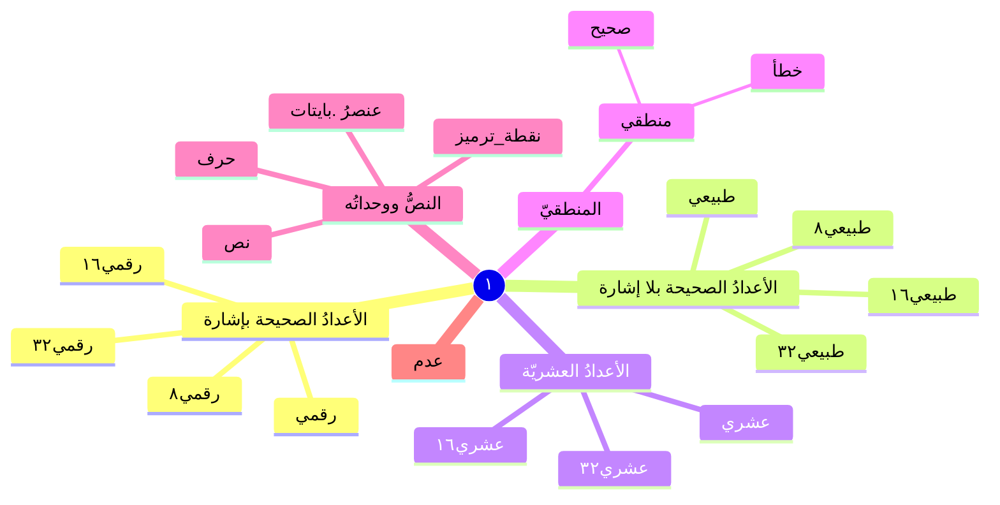

### ٢ · الأنواعُ المركّبة

> ما يعرّفه المطوّرُ من أنواع: البنيةُ والتعدادُ والصفّ.

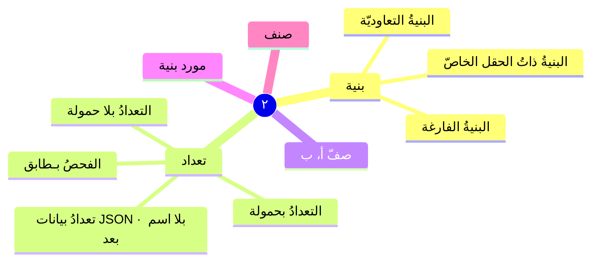

### ٣ · الحاويات

> أنواعُ المكتبة القياسيّة التي تحمل عناصر، وكلُّها معمَّمة.

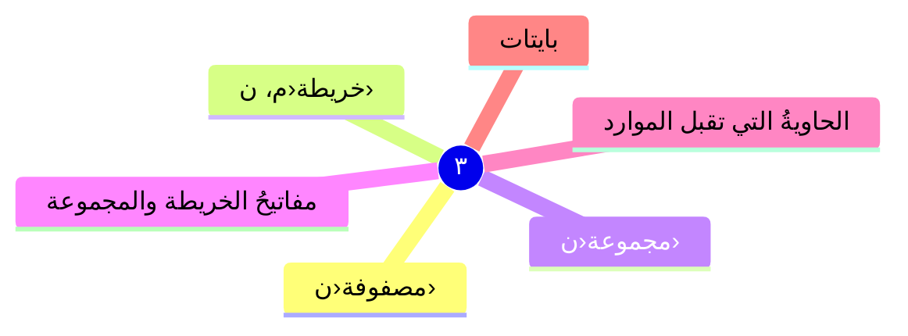

### ٤ · الغيابُ والفشلُ والخلل

> `اختياري<ن>` و`نتيجة` وأنواعُ الخطأ، وصنفُ الخلل المستقلّ.

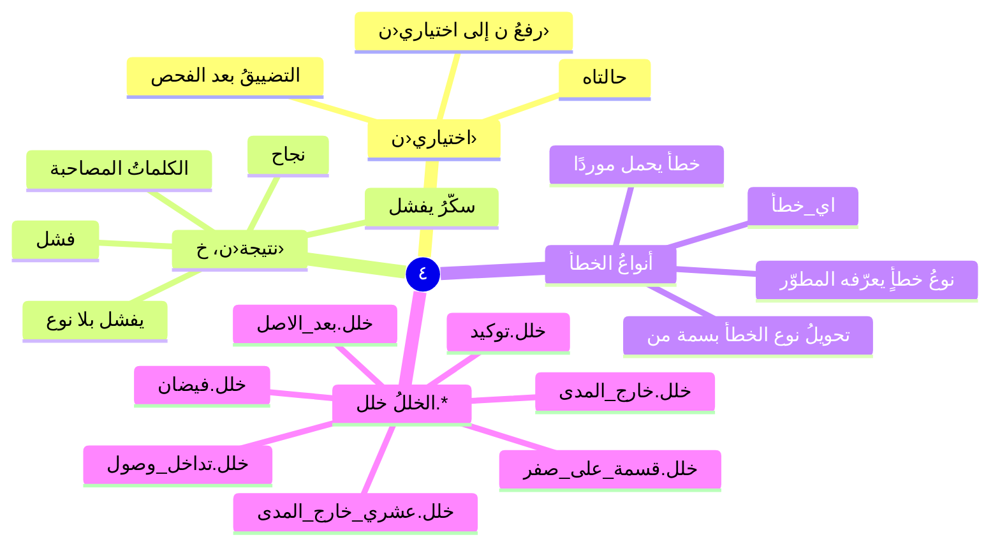

### ٥ · الدوالُّ والمغلَقات

> الدالّةُ قيمة: نوعُها، والدالّةُ المسمّاة، والمغلَقُ وما يلتقطه.

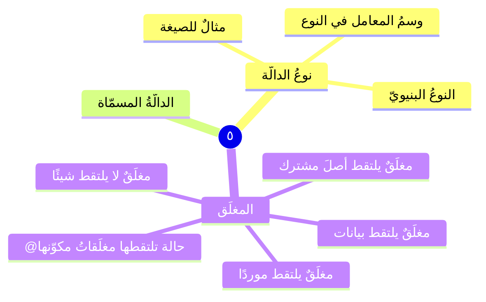

### ٦ · السماتُ وتعدّدُ الأشكال

> العقدُ المشترك بين الأنواع، والمطابقة، والإرسالُ الديناميّ.

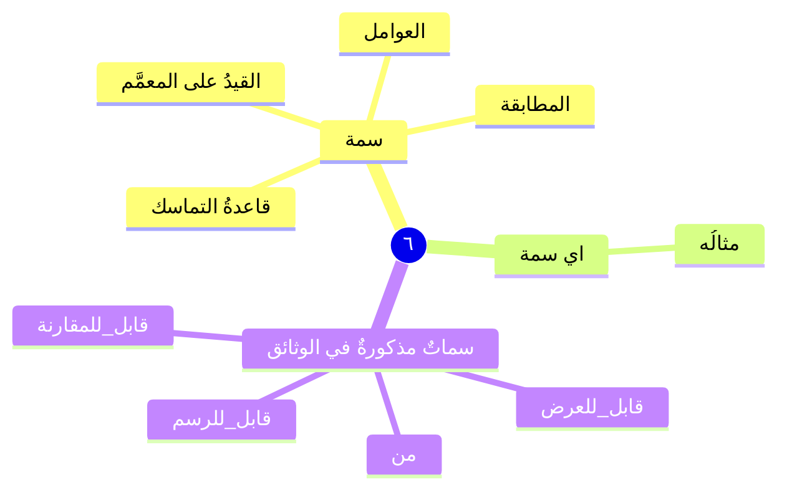

### ٧ · المعمَّمات

> معاملُ النوع وقيوده، والتخصيص، والأنواعُ المعمَّمة في المكتبة.

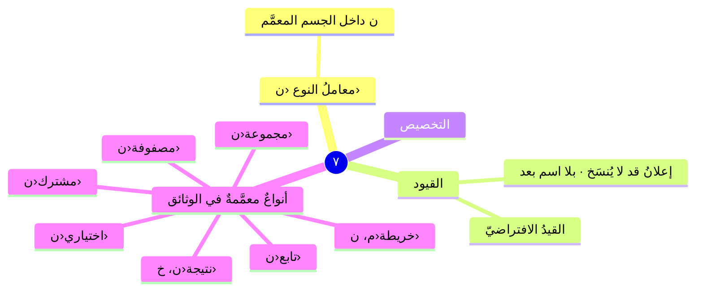

### ٨ · أنواعُ الملكيّة

> الصندوقُ المشترك وتابعُه، والمراجعُ الصريحة، ومكانُ حالة الواجهة.

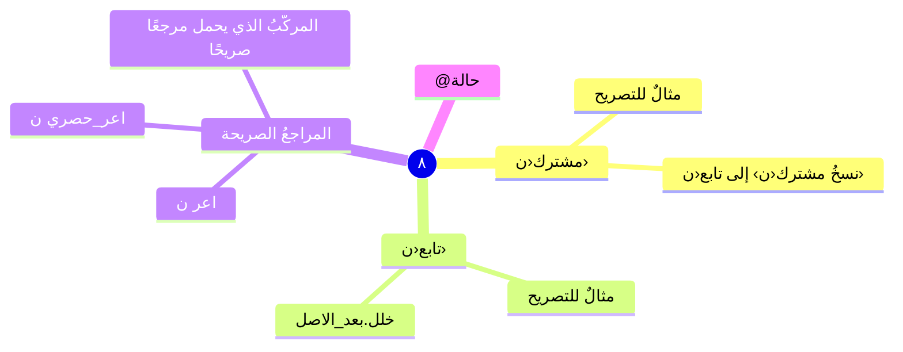

### ٩ · الموارد

> ما لا يُنسَخ: الموردُ المُعلَن، والمركّبُ بالعدوى، ومواردُ المكتبة القياسيّة بفئاتها.

#### المنطقةُ دون «مواردُ المكتبة القياسيّة»

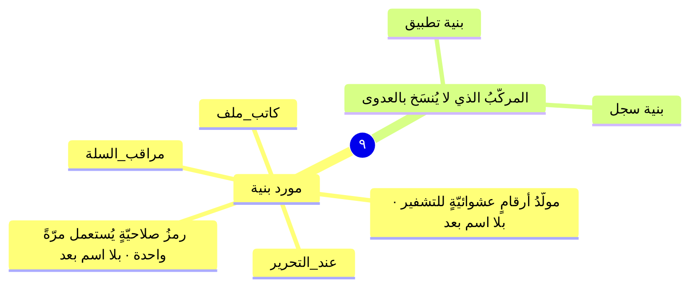

#### مواردُ المكتبة القياسيّة دون «العتادُ والمنصّة»

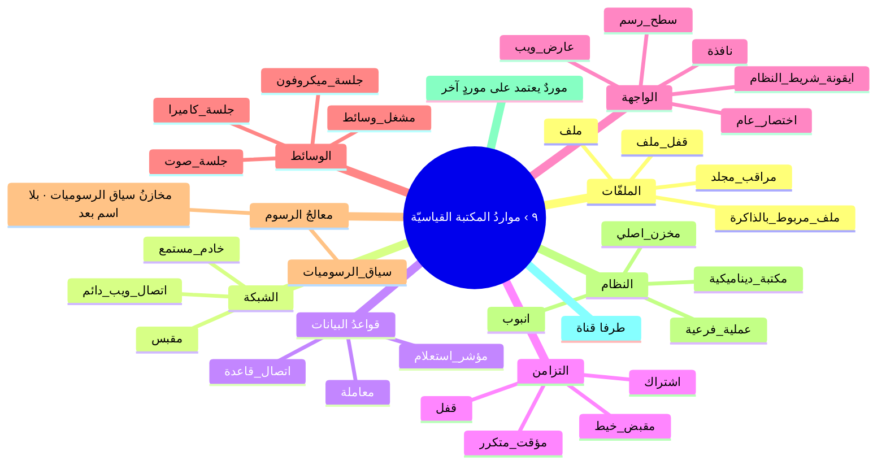

#### العتادُ والمنصّة

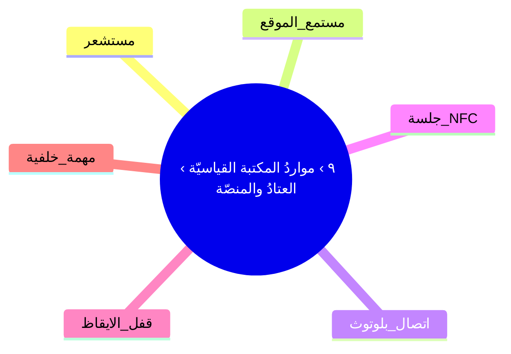

### ١٠ · التحويلات

> ما يتحوّل ضمنًا، وما يُحوَّل صراحةً، ونوعُ الحرفيّة.

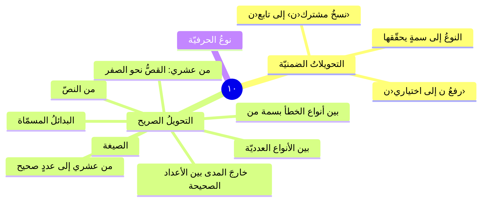

### ١١ · التغليفُ والظهور

> من يرى حقولَ النوع وطرقَه: ثلاثُ درجات، والملفُّ حدُّ الخصوصيّة.

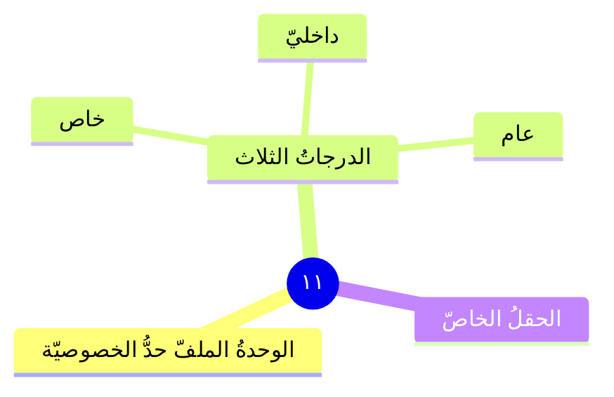

### ١٢ · هويّةُ النوع وما يحسبه المترجم

> الاسميّةُ والبنيويّة، والصفاتُ المحسوبة، والمشتقّات، والتمثيل.

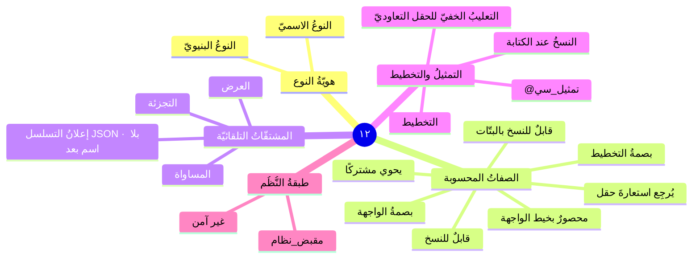

### ١٣ · خارجَ التصنيف بعد

> أنواعٌ ذكرتها الوثائقُ ولم تُصنَّف، وأنواعٌ مرشّحةٌ للنقاش.

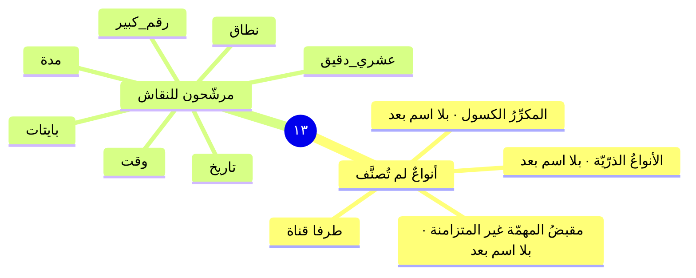

---

## ٣ · الشجرةُ نصًّا

### ١ · الأنواعُ الأوّليّة

- **الأعدادُ الصحيحة بإشارة** — أربعةُ أعراض: ٨ و١٦ و٣٢ و٦٤ بتًّا، والاسمُ المجرّد عرضُ ٦٤ <sub>١.١ · قائمة الأنواع › ١‑أ · الأعراض</sub>
  - `رقمي` — عددٌ صحيحٌ بإشارة، عرضُه ٦٤ بتًّا ‹أ · بيانات› ← انظر [الملكيّة ٢ › الأوّليّة](../../الملكية/خارطة/خارطة_نظام_الملكية.html#٢.٥.١.١) ≈ <code dir="ltr">int · Int · i64</code> <sub>١.١.١ · قائمة الأنواع › ١ · الأنواعُ الأوّليّة</sub>
  - `رقمي٣٢` — عددٌ صحيحٌ بإشارة، عرضُه ٣٢ بتًّا ‹أ · بيانات› ← انظر [الملكيّة ٢ › الأوّليّة](../../الملكية/خارطة/خارطة_نظام_الملكية.html#٢.٥.١.١) ≈ <code dir="ltr">i32</code> <sub>١.١.٢</sub>
  - `رقمي١٦` — عددٌ صحيحٌ بإشارة، عرضُه ١٦ بتًّا ‹أ · بيانات› ← انظر [الملكيّة ٢ › الأوّليّة](../../الملكية/خارطة/خارطة_نظام_الملكية.html#٢.٥.١.١) ≈ <code dir="ltr">i16</code> <sub>١.١.٣</sub>
  - `رقمي٨` — عددٌ صحيحٌ بإشارة، عرضُه ٨ بتّات ‹أ · بيانات› ← انظر [الملكيّة ٢ › الأوّليّة](../../الملكية/خارطة/خارطة_نظام_الملكية.html#٢.٥.١.١) ≈ <code dir="ltr">i8</code> <sub>١.١.٤</sub>
- **الأعدادُ الصحيحة بلا إشارة** — أربعةُ أعراض: ٨ و١٦ و٣٢ و٦٤ بتًّا، والاسمُ المجرّد عرضُ ٦٤ <sub>١.٢ · قائمة الأنواع › ١‑أ · الأعراض</sub>
  - `طبيعي` — عددٌ صحيحٌ بلا إشارة، عرضُه ٦٤ بتًّا ‹أ · بيانات› ← انظر [الملكيّة ٢ › الأوّليّة](../../الملكية/خارطة/خارطة_نظام_الملكية.html#٢.٥.١.١) ≈ <code dir="ltr">ulong · UInt · u64</code> <sub>١.٢.١ · قائمة الأنواع › ١ · الأنواعُ الأوّليّة</sub>
  - `طبيعي٣٢` — عددٌ صحيحٌ بلا إشارة، عرضُه ٣٢ بتًّا ‹أ · بيانات› ← انظر [الملكيّة ٢ › الأوّليّة](../../الملكية/خارطة/خارطة_نظام_الملكية.html#٢.٥.١.١) ≈ <code dir="ltr">u32</code> <sub>١.٢.٢</sub>
  - `طبيعي١٦` — عددٌ صحيحٌ بلا إشارة، عرضُه ١٦ بتًّا ‹أ · بيانات› ← انظر [الملكيّة ٢ › الأوّليّة](../../الملكية/خارطة/خارطة_نظام_الملكية.html#٢.٥.١.١) ≈ <code dir="ltr">u16</code> <sub>١.٢.٣</sub>
  - `طبيعي٨` — عددٌ صحيحٌ بلا إشارة، عرضُه ٨ بتّات، وهو عنصرُ `.بايتات` في النصّ ‹أ · بيانات› ← انظر [الملكيّة ٢ › الأوّليّة](../../الملكية/خارطة/خارطة_نظام_الملكية.html#٢.٥.١.١) ≈ <code dir="ltr">u8 · byte</code> <sub>١.٢.٤</sub>
- **الأعدادُ العشريّة** — ثلاثةُ أعراض: ١٦ و٣٢ و٦٤ بتًّا، على معيار IEEE 754 <sub>١.٣ · قائمة الأنواع › ١‑أ · الأعراض</sub>
  - `عشري` — عددٌ عشريٌّ بعرض ٦٤ بتًّا ‹أ · بيانات› ← انظر [الملكيّة ٢ › الأوّليّة](../../الملكية/خارطة/خارطة_نظام_الملكية.html#٢.٥.١.١) ≈ <code dir="ltr">double · Double · f64</code> <sub>١.٣.١ · قائمة الأنواع › ١ · الأنواعُ الأوّليّة</sub>
  - `عشري٣٢` — عددٌ عشريٌّ بعرض ٣٢ بتًّا ‹أ · بيانات› ← انظر [الملكيّة ٢ › الأوّليّة](../../الملكية/خارطة/خارطة_نظام_الملكية.html#٢.٥.١.١) ≈ <code dir="ltr">float · f32</code> <sub>١.٣.٢</sub>
  - `عشري١٦` — عددٌ عشريٌّ بعرض ١٦ بتًّا: IEEE binary16 ‹أ · بيانات› ← انظر [الملكيّة ٢ › الأوّليّة](../../الملكية/خارطة/خارطة_نظام_الملكية.html#٢.٥.١.١) ≈ <code dir="ltr">f16 · half</code> <sub>١.٣.٣</sub>
- **المنطقيّ** <sub>١.٤ · قائمة الأنواع › ١ · الأنواعُ الأوّليّة</sub>
  - **`منطقي`** — قيمةٌ من اثنتين ‹أ · بيانات› ← انظر [الملكيّة ٢ › الأوّليّة](../../الملكية/خارطة/خارطة_نظام_الملكية.html#٢.٥.١.٢) ≈ <code dir="ltr">bool · Bool</code> <sub>١.٤.١</sub>
    - `صحيح` — إحدى قيمتَي المنطقيّ ≈ <code dir="ltr">true</code> <sub>١.٤.١.١</sub>
    - `خطأ` — القيمةُ الأخرى ≈ <code dir="ltr">false</code> <sub>١.٤.١.٢</sub>
- **النصُّ ووحداتُه** <sub>١.٥ · نظام الأنواع (ق‑٤) › ٢‑١١ · النصّ</sub>
  - `نص` — سلسلةُ حروفٍ بترميز UTF‑8، و`طول("مُحَمَّد")` = ٤ ‹أ · بيانات› ← انظر [الملكيّة ٢ › الأوّليّة](../../الملكية/خارطة/خارطة_نظام_الملكية.html#٢.٥.١.٤) ≈ <code dir="ltr">String</code> <sub>١.٥.١</sub>
  - `حرف` — عنقودٌ مرئيّ: الحرفُ مع تشكيله، وهو وحدةُ `نص` ‹أ · بيانات› ← انظر [الملكيّة ٢ › الأوّليّة](../../الملكية/خارطة/خارطة_نظام_الملكية.html#٢.٥.١.٣) ≈ <code dir="ltr">Character (Swift)</code> <sub>١.٥.٢</sub>
  - `نقطة_ترميز` — نقطةُ يونيكود واحدة، وعنصرُ `.نقاط_الترميز` ≈ <code dir="ltr">Unicode.Scalar · char</code> <sub>١.٥.٣ · قائمة الأنواع › ١‑ب · ما دون الحرف</sub>
  - _عنصرُ `.بايتات`_ ← انظر ١ › الأعدادُ الصحيحة بلا إشارة ‹١.٢.٤› <sub>١.٥.٤</sub>
- `عدم` — نوعٌ له قيمةٌ واحدة، تُرجعه الدالّةُ التي لا تُرجع شيئًا ‹اسمٌ مؤقّت› ‹أ · بيانات› ← انظر [الملكيّة ٢ › الأوّليّة](../../الملكية/خارطة/خارطة_نظام_الملكية.html#٢.٥.١.٥) ≈ <code dir="ltr">void · ()</code> <sub>١.٦ · قائمة الأنواع › ١ · الأنواعُ الأوّليّة</sub>

### ٢ · الأنواعُ المركّبة

- **`بنية`** — حقولٌ مسمّاة، بلا وراثة. وهي المركّبُ الوحيد ‹الأسرةُ من أجزائه› ← انظر [الملكيّة ٢ › المركّبة](../../الملكية/خارطة/خارطة_نظام_الملكية.html#٢.٥.٢.١) ≈ <code dir="ltr">struct</code> <sub>٢.١ · نظام الأنواع (ق‑٤) › ٢‑٤ · الأنواعُ المركّبة</sub>
  - البنيةُ الفارغة — بنيةٌ بلا حقول ‹أ · بيانات› ← انظر [الملكيّة ٢ › المركّبة](../../الملكية/خارطة/خارطة_نظام_الملكية.html#٢.٥.٢.٢) <sub>٢.١.١</sub>
  - البنيةُ التعاوديّة — حقلٌ من نوع البنية نفسِها، كـ`رد؟ الرد_عليه` في `بنية رد` ← انظر أيضًا ١٢ › التمثيلُ والتخطيط ‹١٢.٤.٣› ← انظر [الملكيّة ٥ › بنًى خاصّة](../../الملكية/خارطة/خارطة_نظام_الملكية.html#٥.٨.١) <sub>٢.١.٢ · نظام الأنواع (ق‑٤) › ٢‑٩</sub>
  - _البنيةُ ذاتُ الحقل الخاصّ_ ← انظر ١١ › الحقلُ الخاصّ ‹١١.٣› <sub>٢.١.٣</sub>
- **`تعداد`** — حالاتٌ، ولكلّ حالةٍ حمولةٌ إن شاءت ‹الأسرةُ من أجزائه› ← انظر [الملكيّة ٢ › المركّبة](../../الملكية/خارطة/خارطة_نظام_الملكية.html#٢.٥.٢.٣) ≈ <code dir="ltr">enum (Swift · Rust)</code> <sub>٢.٢ · قائمة الأنواع › ٢ · الأنواعُ المركّبة</sub>
  - التعدادُ بلا حمولة — حالاتٌ لا تحمل بيانات ‹أ · بيانات› ← انظر [الملكيّة ٢ › المركّبة](../../الملكية/خارطة/خارطة_نظام_الملكية.html#٢.٥.٢.٢) <sub>٢.٢.١</sub>
  - التعدادُ بحمولة — كلُّ حالةٍ تحمل بياناتها ‹الأسرةُ من أجزائه› ← انظر [الملكيّة ٢ › المركّبة](../../الملكية/خارطة/خارطة_نظام_الملكية.html#٢.٥.٢.٣) <sub>٢.٢.٢</sub>
  - الفحصُ بـ`طابق` — فحصٌ يمرّ على حالات التعداد كلّها ← انظر [الملكيّة ٣ › الربطُ بالأنماط](../../الملكية/خارطة/خارطة_نظام_الملكية.html#٣.٧.٢) ≈ <code dir="ltr">match · switch</code> <sub>٢.٢.٣</sub>
  - تعدادُ بيانات JSON _(بلا اسم بعد)_ — تعدادٌ في المكتبة يمثّل بياناتِ JSON ≈ <code dir="ltr">serde_json::Value</code> <sub>٢.٢.٤ · نظام الأنواع (ق‑٤) › ٢‑١ · ساكنٌ تامّ</sub>
- صفّ `(أ، ب)` — قيمٌ مرتّبةٌ بلا أسماء ‹الأسرةُ من أجزائه› ← انظر [الملكيّة ٢ › المركّبة](../../الملكية/خارطة/خارطة_نظام_الملكية.html#٢.٥.٢.٤) ≈ <code dir="ltr">tuple</code> <sub>٢.٣ · قائمة الأنواع › ٢ · الأنواعُ المركّبة</sub>
- _`مورد بنية`_ ← انظر ٩ › مورد بنية ‹٩.١› <sub>٢.٤</sub>
- _`صنف`_ — كلمةٌ متروكة: المركّبُ اسمُه `بنية` ← انظر ٢ › بنية ‹٢.١› ≈ <code dir="ltr">class</code> <sub>٢.٥</sub>

### ٣ · الحاويات

- `مصفوفة<ن>` — قائمةٌ مرتّبةٌ متغيّرةُ الطول ‹الأسرةُ من أجزائه› ← انظر [الملكيّة ٢ › الحاويات](../../الملكية/خارطة/خارطة_نظام_الملكية.html#٢.٥.٣.١) ≈ <code dir="ltr">Array · Vec</code> <sub>٣.١ · قائمة الأنواع › ٣ · أنواعُ المكتبة القياسيّة</sub>
- `خريطة<م، ن>` — مفتاحٌ إلى قيمة ‹الأسرةُ من أجزائه› ← انظر [الملكيّة ٢ › الحاويات](../../الملكية/خارطة/خارطة_نظام_الملكية.html#٢.٥.٣.٢) ≈ <code dir="ltr">Dictionary · HashMap</code> <sub>٣.٢ · قائمة الأنواع › ٣ · أنواعُ المكتبة القياسيّة</sub>
- `مجموعة<ن>` — عناصرُ بلا تكرار ‹الأسرةُ من أجزائه› ← انظر [الملكيّة ٢ › الحاويات](../../الملكية/خارطة/خارطة_نظام_الملكية.html#٢.٥.٣.٣) ≈ <code dir="ltr">Set</code> <sub>٣.٣ · قائمة الأنواع › ٣ · أنواعُ المكتبة القياسيّة</sub>
- مفاتيحُ الخريطة والمجموعة — نوعُ `م` في الخريطة، ونوعُ العنصر في المجموعة ‹أ · بيانات› ← انظر [الملكيّة ٢ › الحاويات](../../الملكية/خارطة/خارطة_نظام_الملكية.html#٢.٥.٣.٤) <sub>٣.٤ · تصنيف أنواع البيانات › ٤‑ب</sub>
- _الحاويةُ التي تقبل الموارد_ ← انظر ٧ › القيود ‹٧.٢.٢› <sub>٣.٥</sub>
- _`بايتات`_ ← انظر ١٣ › مرشّحون للنقاش ‹١٣.٢.٦› <sub>٣.٦</sub>

### ٤ · الغيابُ والفشلُ والخلل

- **`اختياري<ن>`** — قيمةٌ أو غياب: تعدادٌ في المكتبة بحالتين ‹الأسرةُ من أجزائه› ← انظر [الملكيّة ٢ › المركّبة](../../الملكية/خارطة/خارطة_نظام_الملكية.html#٢.٥.٢.٥) ≈ <code dir="ltr">Optional · Option</code> <sub>٤.١ · نظام الأنواع (ق‑٤) › ٢‑٥ · لا عدم</sub>
  - حالتاه — موجودٌ بقيمته، أو غائب. وفي أمثلة نظام الأنواع يُقارَن الغائبُ بـ`لاشيء` ≈ <code dir="ltr">some · none · nil</code> <sub>٤.١.١</sub>
  - التضييقُ بعد الفحص — `اختياري<نص>` يصير `نص` بعد فحصه ← انظر [الملكيّة ٣ › الربطُ بالأنماط](../../الملكية/خارطة/خارطة_نظام_الملكية.html#٣.٧.٣) <sub>٤.١.٢</sub>
  - _رفعُ `ن` إلى `اختياري<ن>`_ ← انظر ١٠ › التحويلاتُ الضمنيّة ‹١٠.١.١› <sub>٤.١.٣</sub>
- **`نتيجة<ن، خ>`** — نجاحٌ بقيمة أو فشلٌ بخطأ: تعدادٌ في المكتبة ‹الأسرةُ من أجزائه› ← انظر [الملكيّة ٢ › المركّبة](../../الملكية/خارطة/خارطة_نظام_الملكية.html#٢.٥.٢.٦) ≈ <code dir="ltr">Result</code> <sub>٤.٢ · DECISIONS.md › الفشل › (أ) الفشلُ المتوقَّع</sub>
  - `نجاح` — حالةُ النجاح، وتحمل القيمة ≈ <code dir="ltr">Ok</code> <sub>٤.٢.١</sub>
  - `فشل` — حالةُ الفشل، وتحمل الخطأ ≈ <code dir="ltr">Err</code> <sub>٤.٢.٢</sub>
  - سكّرُ `يفشل` — `ترجع رقمي يفشل خ` تُقرأ `ترجع نتيجة<رقمي، خ>` ≈ <code dir="ltr">-> Result<i64, E></code> <sub>٤.٢.٣</sub>
  - `يفشل` بلا نوع — `ترجع رقمي يفشل` تُقرأ `ترجع نتيجة<رقمي، اي_خطأ>` ≈ <code dir="ltr">-> Result<i64, Box<dyn Error>></code> <sub>٤.٢.٤</sub>
  - الكلماتُ المصاحبة — `افشل` · `حاول` · `والا` ≈ <code dir="ltr">return Err · ? · unwrap_or</code> <sub>٤.٢.٥</sub>
- **أنواعُ الخطأ** — النوعُ `خ` في `نتيجة<ن، خ>` <sub>٤.٣ · DECISIONS.md › الفشل › (أ) الفشلُ المتوقَّع</sub>
  - `اي_خطأ` — أيُّ خطأ، ويُفَكّ إليه `يفشل` بلا نوع ≈ <code dir="ltr">Box<dyn Error> · any Error</code> <sub>٤.٣.١ · قائمة الأنواع › ٣ · أنواعُ المكتبة القياسيّة</sub>
  - نوعُ خطأٍ يعرّفه المطوّر — في الأمثلة: `خطأ_سحب` بحالته `خطأ_سحب.لا_يكفي` · `خطأ_اعدادات` · `خطأ_ملف` <sub>٤.٣.٢</sub>
  - _تحويلُ نوع الخطأ بسمة `من`_ ← انظر ٦ › سماتٌ مذكورةٌ في الوثائق ‹٦.٣.١› <sub>٤.٣.٣</sub>
  - خطأٌ يحمل موردًا ← انظر [الملكيّة ٢ › حالاتٌ حدّيّةٌ مع الموارد](../../الملكية/خارطة/خارطة_نظام_الملكية.html#٢.٨.٥) <sub>٤.٣.٤</sub>
- **الخللُ `خلل.*`** — صنفٌ مستقلٌّ عن الفشل، وأعضاؤه مسمّاة ← انظر [الملكيّة ١٠ › الخللُ المسمّى](../../الملكية/خارطة/خارطة_نظام_الملكية.html#١٠.٤) ≈ <code dir="ltr">panic · fatalError</code> <sub>٤.٤ · DECISIONS.md › الفشل › (ب) الخللُ البرمجيّ</sub>
  - `خلل.فيضان` — فيضانُ عددٍ صحيح، في كلّ عرض ← انظر [الملكيّة ١٠ › الخللُ المسمّى](../../الملكية/خارطة/خارطة_نظام_الملكية.html#١٠.٤.٣) <sub>٤.٤.١</sub>
  - `خلل.خارج_المدى` — وصولٌ بفهرسٍ خارجَ حدود الحاوية ← انظر [الملكيّة ١٠ › الخللُ المسمّى](../../الملكية/خارطة/خارطة_نظام_الملكية.html#١٠.٤.٤) <sub>٤.٤.٢</sub>
  - `خلل.قسمة_على_صفر` — قسمةٌ على صفر ← انظر [الملكيّة ١٠ › الخللُ المسمّى](../../الملكية/خارطة/خارطة_نظام_الملكية.html#١٠.٤.٥) <sub>٤.٤.٣</sub>
  - `خلل.بعد_الاصل` — وصولٌ عبر `تابع<ن>` بعد موت أصله ← انظر [الملكيّة ١٠ › الخللُ المسمّى](../../الملكية/خارطة/خارطة_نظام_الملكية.html#١٠.٤.١) <sub>٤.٤.٤</sub>
  - `خلل.تداخل_وصول` — وصولٌ يتداخل مع مدّة كتابة ← انظر [الملكيّة ١٠ › الخللُ المسمّى](../../الملكية/خارطة/خارطة_نظام_الملكية.html#١٠.٤.٢) <sub>٤.٤.٥</sub>
  - `خلل.توكيد` — من `اكّد`، دالّةٍ في المكتبة ← انظر [الملكيّة ١٠ › الخللُ المسمّى](../../الملكية/خارطة/خارطة_نظام_الملكية.html#١٠.٤.٦) ≈ <code dir="ltr">assert</code> <sub>٤.٤.٦</sub>
  - `خلل.عشري_خارج_المدى` — تحويلُ `عشري` إلى عددٍ صحيح وهو ∞ أو NaN أو خارجَ مدى الهدف ‹اسمٌ مؤقّت› <sub>٤.٤.٧ · قائمة الأنواع › ١‑أ · الأعراض</sub>

### ٥ · الدوالُّ والمغلَقات

- **نوعُ الدالّة** — الدالّةُ قيمةٌ تُمرَّر وتُخزَّن ‹صيغتُه لم تُقرَّر› ≈ <code dir="ltr">(Int) -> Bool · fn(i64) -> bool</code> <sub>٥.١ · قائمة الأنواع › ٤ · الدوالّ والمغلَقات</sub>
  - مثالٌ للصيغة — `دالة(رقمي، نص) ترجع منطقي`، من قائمة الأنواع <sub>٥.١.١</sub>
  - وسمُ المعامل في النوع — نوعُ الدالّة يحمل `قابل_للتعديل` على معاملاتها <sub>٥.١.٢ · نظام الأنواع (ق‑٤) › ١ · ما تفرضه القراراتُ المعتمَدة</sub>
  - _النوعُ البنيويّ_ ← انظر ١٢ › هويّةُ النوع ‹١٢.١.٢› <sub>٥.١.٣</sub>
- الدالّةُ المسمّاة — دالّةٌ تُعلَن باسمها: `دالة متوسط(مصفوفة<عشري> درجات) ترجع عشري` ‹أ · بيانات› ← انظر [الملكيّة ٢ › الدوالُّ والمغلَقات](../../الملكية/خارطة/خارطة_نظام_الملكية.html#٢.٥.٥.١) <sub>٥.٢</sub>
- **المغلَق** — دالّةٌ تلتقط من محيطها نسخًا ≈ <code dir="ltr">closure · lambda</code> <sub>٥.٣ · نظام الأنواع (ق‑٤) › ٢‑١٢ · المغلَقات</sub>
  - مغلَقٌ لا يلتقط شيئًا ‹أ · بيانات› ← انظر [الملكيّة ٢ › الدوالُّ والمغلَقات](../../الملكية/خارطة/خارطة_نظام_الملكية.html#٢.٥.٥.١) <sub>٥.٣.١</sub>
  - مغلَقٌ يلتقط بيانات ‹أ · بيانات› ← انظر [الملكيّة ٢ › الدوالُّ والمغلَقات](../../الملكية/خارطة/خارطة_نظام_الملكية.html#٢.٥.٥.٢) <sub>٥.٣.٢</sub>
  - مغلَقٌ يلتقط أصلَ `مشترك` — يلتقط تابعًا ‹أ · بيانات› ← انظر [الملكيّة ٢ › الدوالُّ والمغلَقات](../../الملكية/خارطة/خارطة_نظام_الملكية.html#٢.٥.٥.٣) <sub>٥.٣.٣</sub>
  - مغلَقٌ يلتقط موردًا ‹الأسرةُ لم تُتناوَل› ← انظر [الملكيّة ٢ › الدوالُّ والمغلَقات](../../الملكية/خارطة/خارطة_نظام_الملكية.html#٢.٥.٥.٤) <sub>٥.٣.٤</sub>
  - _`@حالة` تلتقطها مغلَقاتُ مكوّنها_ ← انظر ٨ › @حالة ‹٨.٤› <sub>٥.٣.٥</sub>

### ٦ · السماتُ وتعدّدُ الأشكال

- **`سمة`** — عقدٌ من الطرق، قد يكون لبعضها تنفيذٌ افتراضيّ ≈ <code dir="ltr">protocol · trait · interface</code> <sub>٦.١ · نظام الأنواع (ق‑٤) › ٢‑٦ · تعدّدُ الأشكال بالسمات</sub>
  - المطابقة — تُعلَن صراحةً: `بنية مهمة تحقق قابل_للعرض` ≈ <code dir="ltr">: Protocol · impl Trait for T</code> <sub>٦.١.١</sub>
  - قاعدةُ التماسك — موضعُ إعلان المطابقة: وحدةُ النوع ووحدةُ السمة ≈ <code dir="ltr">orphan rule</code> <sub>٦.١.٢</sub>
  - العوامل — `+` و`==` و`<` طرقٌ في سمات ≈ <code dir="ltr">operator traits</code> <sub>٦.١.٣</sub>
  - _القيدُ على المعمَّم_ ← انظر ٧ › القيود ‹٧.٢› <sub>٦.١.٤</sub>
- **`اي سمة`** — قيمةٌ نوعُها الفعليّ مجهولٌ وقتَ الترجمة، ويُستدعى عليها ما في السمة ‹الأسرةُ تُعلَن في السمة› ← انظر [الملكيّة ٢ › الديناميّة](../../الملكية/خارطة/خارطة_نظام_الملكية.html#٢.٥.٦.١) ≈ <code dir="ltr">any P · dyn Trait</code> <sub>٦.٢ · قائمة الأنواع › ٦ · الأنواعُ الديناميّة</sub>
  - مثالُه — `مصفوفة<اي قابل_للرسم>` <sub>٦.٢.١</sub>
- **سماتٌ مذكورةٌ في الوثائق** <sub>٦.٣</sub>
  - `من` — سمةُ التحويل بين أنواع الخطأ ‹اسمٌ مؤقّت› ≈ <code dir="ltr">From</code> <sub>٦.٣.١ · DECISIONS.md › الفشل › (أ) الفشلُ المتوقَّع</sub>
  - `قابل_للعرض` — مثالُ المطابقة في نظام الأنواع <sub>٦.٣.٢</sub>
  - `قابل_للمقارنة` — مثالُ القيد في نظام الأنواع ≈ <code dir="ltr">Comparable · Ord</code> <sub>٦.٣.٣</sub>
  - `قابل_للرسم` — مثالُ الإرسال الديناميّ في نظام الأنواع <sub>٦.٣.٤</sub>

### ٧ · المعمَّمات

- **معاملُ النوع `<ن>`** — نوعٌ يُعطى عند الاستعمال: `دالة كرر<ن>(ن قيمة، رقمي مرات) ترجع مصفوفة<ن>` ← انظر [الملكيّة ٢ › المعمَّمة](../../الملكية/خارطة/خارطة_نظام_الملكية.html#٢.٥.٧.١) ≈ <code dir="ltr"><T> · generics</code> <sub>٧.١ · نظام الأنواع (ق‑٤) › ٢‑٧ · المعمَّمات</sub>
  - `ن` داخل الجسم المعمَّم ← انظر [الملكيّة ٢ › المعمَّمة](../../الملكية/خارطة/خارطة_نظام_الملكية.html#٢.٥.٧.٢) <sub>٧.١.١</sub>
- **القيود** — قيدُ سمةٍ على معامل النوع: `<ن: قابل_للمقارنة>` ≈ <code dir="ltr"><T: Comparable></code> <sub>٧.٢ · نظام الأنواع (ق‑٤) › ٢‑٦</sub>
  - القيدُ الافتراضيّ — قيدُ معامل النوع حين لا يُكتب قيد ≈ <code dir="ltr">Copyable</code> <sub>٧.٢.١</sub>
  - إعلانُ «قد لا يُنسَخ» _(بلا اسم بعد)_ — يكتبه كاتبُ المعمَّم ليقبل الموارد ← انظر [الملكيّة ٢ › محاورُ الحكم في كلّ أسرة](../../الملكية/خارطة/خارطة_نظام_الملكية.html#٢.٣.١٠) ≈ <code dir="ltr">~Copyable</code> <sub>٧.٢.٢</sub>
- التخصيص — نسخةٌ من المعمَّم لكلّ نوعٍ وقتَ الترجمة ≈ <code dir="ltr">monomorphization</code> <sub>٧.٣ · نظام الأنواع (ق‑٤) › ٢‑٧ · المعمَّمات</sub>
- **أنواعٌ معمَّمةٌ في الوثائق** <sub>٧.٤</sub>
  - _`مصفوفة<ن>`_ ← انظر ٣ › مصفوفة<ن> ‹٣.١› <sub>٧.٤.١</sub>
  - _`خريطة<م، ن>`_ ← انظر ٣ › خريطة<م، ن> ‹٣.٢› <sub>٧.٤.٢</sub>
  - _`مجموعة<ن>`_ ← انظر ٣ › مجموعة<ن> ‹٣.٣› <sub>٧.٤.٣</sub>
  - _`اختياري<ن>`_ ← انظر ٤ › اختياري<ن> ‹٤.١› <sub>٧.٤.٤</sub>
  - _`نتيجة<ن، خ>`_ ← انظر ٤ › نتيجة<ن، خ> ‹٤.٢› <sub>٧.٤.٥</sub>
  - _`مشترك<ن>`_ ← انظر ٨ › مشترك<ن> ‹٨.١› <sub>٧.٤.٦</sub>
  - _`تابع<ن>`_ ← انظر ٨ › تابع<ن> ‹٨.٢› <sub>٧.٤.٧</sub>

### ٨ · أنواعُ الملكيّة

- **`مشترك<ن>`** — أصلٌ يملك صندوقًا يصل إليه كثيرون ‹ج · مشترك (أصل)› ← انظر [الملكيّة ٢ › أنواعُ الملكيّة](../../الملكية/خارطة/خارطة_نظام_الملكية.html#٢.٥.٨.١) <sub>٨.١ · قائمة الأنواع › ٥ · أنواعُ الملكيّة</sub>
  - مثالٌ للتصريح — `مشترك<سلة> السلة` <sub>٨.١.١</sub>
  - _نسخُ `مشترك<ن>` إلى `تابع<ن>`_ ← انظر ١٠ › التحويلاتُ الضمنيّة ‹١٠.١.٣› <sub>٨.١.٢</sub>
- **`تابع<ن>`** — يصل إلى الصندوق ولا يملكه ‹اسمٌ مؤقّت› ‹ج · مشترك (تابع)› ← انظر [الملكيّة ٢ › أنواعُ الملكيّة](../../الملكية/خارطة/خارطة_نظام_الملكية.html#٢.٥.٨.٢) ≈ <code dir="ltr">weak (تقريبًا)</code> <sub>٨.٢ · قائمة الأنواع › ٥ · أنواعُ الملكيّة</sub>
  - مثالٌ للتصريح — `تابع<سلة> السلة` <sub>٨.٢.١</sub>
  - _`خلل.بعد_الاصل`_ ← انظر ٤ › الخللُ خلل.* ‹٤.٤.٤› <sub>٨.٢.٢</sub>
- **المراجعُ الصريحة** — لمطوّر النُّظُم وحده ‹د · مرجعٌ صريح› ← انظر [الملكيّة ١١ › اعر واعر_حصري](../../الملكية/خارطة/خارطة_نظام_الملكية.html#١١.٢) <sub>٨.٣ · تصنيف أنواع البيانات › ٤‑هـ · أنواعُ الملكيّة</sub>
  - `اعر ن` — مرجعٌ صريحٌ بعمر ‹د · مرجعٌ صريح› ← انظر [الملكيّة ٢ › أنواعُ الملكيّة](../../الملكية/خارطة/خارطة_نظام_الملكية.html#٢.٥.٨.٣) ≈ <code dir="ltr">&T</code> <sub>٨.٣.١</sub>
  - `اعر_حصري ن` — مرجعٌ صريحٌ حصريٌّ بعمر ‹د · مرجعٌ صريح› ← انظر [الملكيّة ٢ › أنواعُ الملكيّة](../../الملكية/خارطة/خارطة_نظام_الملكية.html#٢.٥.٨.٣) ≈ <code dir="ltr">&mut T</code> <sub>٨.٣.٢</sub>
  - المركّبُ الذي يحمل مرجعًا صريحًا — مثالُه `بنية قارئ` بحقلها `اعر_حصري نص المخزن` ‹د · مرجعٌ صريح› ← انظر [الملكيّة ٢ › تعيينُ الأسرة: خطواتُ المترجم](../../الملكية/خارطة/خارطة_نظام_الملكية.html#٢.٢.٥) <sub>٨.٣.٣</sub>
- `@حالة` — ليست نوعًا: مكانُ تخزينٍ لحالة الواجهة ← انظر [الملكيّة ٢ › الدوالُّ والمغلَقات](../../الملكية/خارطة/خارطة_نظام_الملكية.html#٢.٥.٥.٥) ≈ <code dir="ltr">@State</code> <sub>٨.٤ · قائمة الأنواع › ٥ · أنواعُ الملكيّة</sub>

### ٩ · الموارد

- **`مورد بنية`** — بنيةٌ لا تُنسَخ، يُعلنها كاتبُ النوع ‹ب١ · موردٌ مُعلَن› ← انظر [الملكيّة ١ › كلماتُ كاتب النوع](../../الملكية/خارطة/خارطة_نظام_الملكية.html#١.٢.٣.١) ≈ <code dir="ltr">~Copyable · !Clone + Drop</code> <sub>٩.١ · تصنيف أنواع البيانات › ١ · أسرُ الملكيّة الأربع</sub>
  - `عند_التحرير` — شفرةُ تحرير المورد، اختياريّة ← انظر [الملكيّة ٨ › شفرةُ التحرير عند_التحرير](../../الملكية/خارطة/خارطة_نظام_الملكية.html#٨.٧) ≈ <code dir="ltr">deinit · Drop</code> <sub>٩.١.١ · تصنيف أنواع البيانات › ٧ · شفرةُ التحرير</sub>
  - مولّدُ أرقامٍ عشوائيّةٍ للتشفير _(بلا اسم بعد)_ — مثالٌ لموردٍ مُعلَن في تصنيف الأنواع ‹ب١ · موردٌ مُعلَن› <sub>٩.١.٢</sub>
  - رمزُ صلاحيّةٍ يُستعمل مرّةً واحدة _(بلا اسم بعد)_ — مثالٌ لموردٍ مُعلَن في تصنيف الأنواع ‹ب١ · موردٌ مُعلَن› <sub>٩.١.٣</sub>
  - `كاتب_ملف` — مثالُ الطريقة المستهلِكة `اغلق(انقل هذا)` في تصنيف الأنواع ‹ب١ · موردٌ مُعلَن› ← انظر [الملكيّة ٨ › شفرةُ التحرير عند_التحرير](../../الملكية/خارطة/خارطة_نظام_الملكية.html#٨.٧.٦) <sub>٩.١.٤</sub>
  - `مراقب_السلة` — مثالُ شفرة التحرير التي تصل عبر `تابع<سلة>` ‹ب١ · موردٌ مُعلَن› ← انظر [الملكيّة ٢ › قاعدةُ المشترك](../../الملكية/خارطة/خارطة_نظام_الملكية.html#٢.٤.١٠) <sub>٩.١.٥</sub>
- **المركّبُ الذي لا يُنسَخ بالعدوى** — مركّبٌ يحمل موردًا أو أصلَ `مشترك` ‹ب٢ · بالعدوى› ← انظر [الملكيّة ٢ › ب · ما لا يُنسَخ](../../الملكية/خارطة/خارطة_نظام_الملكية.html#٢.١.٢.٢) <sub>٩.٢ · تصنيف أنواع البيانات › ٢ · كيف يُعرَف نوعٌ من أيّ أسرة</sub>
  - `بنية سجل` — مثالٌ يحمل `ملف` ‹ب٢ · بالعدوى› <sub>٩.٢.١</sub>
  - `بنية تطبيق` — مثالٌ يحمل `مشترك<سلة>` ‹ب٢ · بالعدوى› <sub>٩.٢.٢</sub>
- **مواردُ المكتبة القياسيّة** — قائمةٌ أوّليّة ‹أسماؤها مؤقّتة› ← انظر [الملكيّة ٢ › فهرسُ الأنواع](../../الملكية/خارطة/خارطة_نظام_الملكية.html#٢.٥.١٠) <sub>٩.٣ · تصنيف أنواع البيانات › ٤‑و · مواردُ المكتبة القياسيّة</sub>
  - **الملفّات** ← انظر [الملكيّة ٢ › مواردُ المكتبة](../../الملكية/خارطة/خارطة_نظام_الملكية.html#٢.٥.١٠.١) <sub>٩.٣.١</sub>
    - `ملف` — ملفٌّ مفتوح ‹اسمٌ مؤقّت› ‹ب١ · موردٌ مُعلَن› ≈ <code dir="ltr">File · FileHandle</code> <sub>٩.٣.١.١</sub>
    - `مراقب_مجلد` ‹اسمٌ مؤقّت› ‹ب١ · موردٌ مُعلَن› <sub>٩.٣.١.٢</sub>
    - `قفل_ملف` ‹اسمٌ مؤقّت› ‹ب١ · موردٌ مُعلَن› <sub>٩.٣.١.٣</sub>
    - `ملف_مربوط_بالذاكرة` ‹اسمٌ مؤقّت› ‹ب١ · موردٌ مُعلَن› ≈ <code dir="ltr">mmap</code> <sub>٩.٣.١.٤</sub>
  - **الشبكة** ← انظر [الملكيّة ٢ › مواردُ المكتبة](../../الملكية/خارطة/خارطة_نظام_الملكية.html#٢.٥.١٠.٢) <sub>٩.٣.٢</sub>
    - `مقبس` ‹اسمٌ مؤقّت› ‹ب١ · موردٌ مُعلَن› ≈ <code dir="ltr">Socket</code> <sub>٩.٣.٢.١</sub>
    - `اتصال_ويب_دائم` ‹اسمٌ مؤقّت› ‹ب١ · موردٌ مُعلَن› ≈ <code dir="ltr">WebSocket</code> <sub>٩.٣.٢.٢</sub>
    - `خادم_مستمع` ‹اسمٌ مؤقّت› ‹ب١ · موردٌ مُعلَن› ≈ <code dir="ltr">TcpListener</code> <sub>٩.٣.٢.٣</sub>
  - **قواعدُ البيانات** ← انظر [الملكيّة ٢ › مواردُ المكتبة](../../الملكية/خارطة/خارطة_نظام_الملكية.html#٢.٥.١٠.٣) <sub>٩.٣.٣</sub>
    - `اتصال_قاعدة` ‹اسمٌ مؤقّت› ‹ب١ · موردٌ مُعلَن› <sub>٩.٣.٣.١</sub>
    - `معاملة` ‹اسمٌ مؤقّت› ‹ب١ · موردٌ مُعلَن› ≈ <code dir="ltr">transaction</code> <sub>٩.٣.٣.٢</sub>
    - `مؤشر_استعلام` ‹اسمٌ مؤقّت› ‹ب١ · موردٌ مُعلَن› ≈ <code dir="ltr">cursor</code> <sub>٩.٣.٣.٣</sub>
  - **التزامن** ← انظر [الملكيّة ٢ › مواردُ المكتبة](../../الملكية/خارطة/خارطة_نظام_الملكية.html#٢.٥.١٠.٤) <sub>٩.٣.٤</sub>
    - `قفل` — قفلٌ في الذاكرة، موردٌ بلا تحريرٍ خاصّ ‹اسمٌ مؤقّت› ‹ب١ · موردٌ مُعلَن› ≈ <code dir="ltr">Mutex</code> <sub>٩.٣.٤.١</sub>
    - `مقبض_خيط` ‹اسمٌ مؤقّت› ‹ب١ · موردٌ مُعلَن› ≈ <code dir="ltr">JoinHandle · Thread</code> <sub>٩.٣.٤.٢</sub>
    - `اشتراك` ‹اسمٌ مؤقّت› ‹ب١ · موردٌ مُعلَن› ≈ <code dir="ltr">subscription</code> <sub>٩.٣.٤.٣</sub>
    - `مؤقت_متكرر` ‹اسمٌ مؤقّت› ‹ب١ · موردٌ مُعلَن› ≈ <code dir="ltr">Timer</code> <sub>٩.٣.٤.٤</sub>
  - **الواجهة** — مربوطةٌ بخيط الواجهة ← انظر [الملكيّة ٢ › مواردُ المكتبة](../../الملكية/خارطة/خارطة_نظام_الملكية.html#٢.٥.١٠.٥) <sub>٩.٣.٥</sub>
    - `نافذة` ‹اسمٌ مؤقّت› ‹ب١ · موردٌ مُعلَن› ≈ <code dir="ltr">Window</code> <sub>٩.٣.٥.١</sub>
    - `سطح_رسم` ‹اسمٌ مؤقّت› ‹ب١ · موردٌ مُعلَن› <sub>٩.٣.٥.٢</sub>
    - `عارض_ويب` ‹اسمٌ مؤقّت› ‹ب١ · موردٌ مُعلَن› ≈ <code dir="ltr">WebView</code> <sub>٩.٣.٥.٣</sub>
    - `ايقونة_شريط_النظام` ‹اسمٌ مؤقّت› ‹ب١ · موردٌ مُعلَن› ≈ <code dir="ltr">tray icon</code> <sub>٩.٣.٥.٤</sub>
    - `اختصار_عام` ‹اسمٌ مؤقّت› ‹ب١ · موردٌ مُعلَن› ≈ <code dir="ltr">global hotkey</code> <sub>٩.٣.٥.٥</sub>
  - **الوسائط** ← انظر [الملكيّة ٢ › مواردُ المكتبة](../../الملكية/خارطة/خارطة_نظام_الملكية.html#٢.٥.١٠.٦) <sub>٩.٣.٦</sub>
    - `مشغل_وسائط` ‹اسمٌ مؤقّت› ‹ب١ · موردٌ مُعلَن› ≈ <code dir="ltr">media player</code> <sub>٩.٣.٦.١</sub>
    - `جلسة_صوت` ‹اسمٌ مؤقّت› ‹ب١ · موردٌ مُعلَن› ≈ <code dir="ltr">audio session</code> <sub>٩.٣.٦.٢</sub>
    - `جلسة_كاميرا` ‹اسمٌ مؤقّت› ‹ب١ · موردٌ مُعلَن› ≈ <code dir="ltr">camera session</code> <sub>٩.٣.٦.٣</sub>
    - `جلسة_ميكروفون` ‹اسمٌ مؤقّت› ‹ب١ · موردٌ مُعلَن› <sub>٩.٣.٦.٤</sub>
  - **العتادُ والمنصّة** ← انظر [الملكيّة ٢ › مواردُ المكتبة](../../الملكية/خارطة/خارطة_نظام_الملكية.html#٢.٥.١٠.٧) <sub>٩.٣.٧</sub>
    - `مستشعر` ‹اسمٌ مؤقّت› ‹ب١ · موردٌ مُعلَن› ≈ <code dir="ltr">sensor</code> <sub>٩.٣.٧.١</sub>
    - `مستمع_الموقع` ‹اسمٌ مؤقّت› ‹ب١ · موردٌ مُعلَن› ≈ <code dir="ltr">location listener</code> <sub>٩.٣.٧.٢</sub>
    - `اتصال_بلوتوث` ‹اسمٌ مؤقّت› ‹ب١ · موردٌ مُعلَن› ≈ <code dir="ltr">Bluetooth</code> <sub>٩.٣.٧.٣</sub>
    - `جلسة_NFC` ‹اسمٌ مؤقّت› ‹ب١ · موردٌ مُعلَن› ≈ <code dir="ltr">NFC session</code> <sub>٩.٣.٧.٤</sub>
    - `قفل_الايقاظ` ‹اسمٌ مؤقّت› ‹ب١ · موردٌ مُعلَن› ≈ <code dir="ltr">wake lock</code> <sub>٩.٣.٧.٥</sub>
    - `مهمة_خلفية` — مهمّةٌ في الخلفيّة على iOS، يلزم إنهاؤها ‹اسمٌ مؤقّت› ‹ب١ · موردٌ مُعلَن› ≈ <code dir="ltr">background task</code> <sub>٩.٣.٧.٦</sub>
  - **معالجُ الرسوم** ← انظر [الملكيّة ٢ › مواردُ المكتبة](../../الملكية/خارطة/خارطة_نظام_الملكية.html#٢.٥.١٠.٨) <sub>٩.٣.٨</sub>
    - `سياق_الرسوميات` ‹اسمٌ مؤقّت› ‹ب١ · موردٌ مُعلَن› ≈ <code dir="ltr">GPU context</code> <sub>٩.٣.٨.١</sub>
    - مخازنُ سياق الرسوميات _(بلا اسم بعد)_ ‹ب١ · موردٌ مُعلَن› ≈ <code dir="ltr">GPU buffers</code> <sub>٩.٣.٨.٢</sub>
  - **النظام** ← انظر [الملكيّة ٢ › مواردُ المكتبة](../../الملكية/خارطة/خارطة_نظام_الملكية.html#٢.٥.١٠.٩) <sub>٩.٣.٩</sub>
    - `عملية_فرعية` ‹اسمٌ مؤقّت› ‹ب١ · موردٌ مُعلَن› ≈ <code dir="ltr">Process · Child</code> <sub>٩.٣.٩.١</sub>
    - `انبوب` ‹اسمٌ مؤقّت› ‹ب١ · موردٌ مُعلَن› ≈ <code dir="ltr">pipe</code> <sub>٩.٣.٩.٢</sub>
    - `مكتبة_ديناميكية` ‹اسمٌ مؤقّت› ‹ب١ · موردٌ مُعلَن› ≈ <code dir="ltr">dylib · DLL</code> <sub>٩.٣.٩.٣</sub>
    - `مخزن_اصلي` — ذاكرةٌ أصليّةٌ مملوكة ‹اسمٌ مؤقّت› ‹ب١ · موردٌ مُعلَن› ≈ <code dir="ltr">native buffer</code> <sub>٩.٣.٩.٤</sub>
  - موردٌ يعتمد على موردٍ آخر — `مؤشر_استعلام` و`معاملة` على `اتصال_قاعدة` ← انظر [الملكيّة ٢ › مواردُ المكتبة](../../الملكية/خارطة/خارطة_نظام_الملكية.html#٢.٥.١٠.١٠) <sub>٩.٣.١٠</sub>
  - _طرفا `قناة`_ ← انظر ١٣ › أنواعٌ لم تُصنَّف ‹١٣.١.٤› <sub>٩.٣.١١</sub>

### ١٠ · التحويلات

- **التحويلاتُ الضمنيّة** — ثلاثةٌ في نظام الأنواع ← انظر [الملكيّة ٣ › بنوعٍ مُعلَن](../../الملكية/خارطة/خارطة_نظام_الملكية.html#٣.٤.١) <sub>١٠.١ · نظام الأنواع (ق‑٤) › ٢‑١ · ساكنٌ تامّ</sub>
  - رفعُ `ن` إلى `اختياري<ن>` ≈ <code dir="ltr">T → Optional<T></code> <sub>١٠.١.١</sub>
  - النوعُ إلى سمةٍ يحقّقها ≈ <code dir="ltr">T → any P</code> <sub>١٠.١.٢</sub>
  - نسخُ `مشترك<ن>` إلى `تابع<ن>` ← انظر [الملكيّة ٢ › قاعدةُ المشترك](../../الملكية/خارطة/خارطة_نظام_الملكية.html#٢.٤.٣) <sub>١٠.١.٣</sub>
- **التحويلُ الصريح** ← انظر [الملكيّة ٣ › بنوعٍ مُعلَن](../../الملكية/خارطة/خارطة_نظام_الملكية.html#٣.٤.٢) <sub>١٠.٢</sub>
  - بين الأنواع العدديّة — بنداءٍ باسم النوع: `رقمي(ق)` · `عشري(درجات.طول())` ≈ <code dir="ltr">Int(x) · x as i64</code> <sub>١٠.٢.١ · نظام الأنواع (ق‑٤) › ٢‑١٠ · الأعداد</sub>
  - _من `عشري` إلى عددٍ صحيح_ ← انظر ٤ › الخللُ خلل.* ‹٤.٤.٧› <sub>١٠.٢.٢</sub>
  - _بين أنواع الخطأ بسمة `من`_ ← انظر ٦ › سماتٌ مذكورةٌ في الوثائق ‹٦.٣.١› <sub>١٠.٢.٣</sub>
  - الصيغة — يُعرَّف في الهدف ويُنادى باسمه: `رقمي(س)` · `عشري(س)` · `طبيعي٨(س)`، ومعه طريقةٌ عامّة `س.الى<ن>()` بمعنى `ن(س)`، فكلُّ بانٍ تصير له `.الى<…>()` ≈ <code dir="ltr">Int64(x) · x.into()</code> <sub>١٠.٢.٤ · قائمة الأنواع › ١‑أ · الأعراض</sub>
  - خارجَ المدى بين الأعداد الصحيحة — `خلل.فيضان`، كحكم `رقمي.اقصى + ١`: `رقمي٨(٣٠٠)` · `طبيعي(-١)` ≈ <code dir="ltr">Int8(300) traps</code> <sub>١٠.٢.٥ · قائمة الأنواع › ١‑أ · الأعراض</sub>
  - البدائلُ المسمّاة — `رقمي٣٢(بالضبط ق)` يُرجع `اختياري<رقمي٣٢>` · `رقمي٨(بالقص ق)` · `رقمي٨(بالتشبع ق)` ≈ <code dir="ltr">exactly: · truncatingIfNeeded: · clamping:</code> <sub>١٠.٢.٦ · قائمة الأنواع › ١‑أ · الأعراض</sub>
  - من `عشري`: القصُّ نحو الصفر — `رقمي(٣٫٧)` = ٣ · `رقمي(-٣٫٧)` = -٣، والتقريبُ بدوالَّ مسمّاة ≈ <code dir="ltr">Int(3.7) == 3</code> <sub>١٠.٢.٧ · قائمة الأنواع › ١‑أ · الأعراض</sub>
  - من النصّ — باسمٍ صريح `من_نص` على النوع الهدف: `رقمي.من_نص("١٢")` يُرجع نتيجةً تُعالَج، فالبانياتُ و`.الى<ن>()` للأعداد وحدها، والعكسُ `نص(ق)` لا يفشل. واسمُ خطئه مقترح: `خطأ_تحليل` ≈ <code dir="ltr">str.parse::<i32>() · strconv.Atoi</code> <sub>١٠.٢.٨ · قائمة الأنواع › ١‑أ · الأعراض</sub>
- نوعُ الحرفيّة — تأخذ نوعَ موضعها، وبلا موضع: `رقمي` للصحيحة و`عشري` لما فيه فاصلة ← انظر [الملكيّة ٣ › من مؤقّت](../../الملكية/خارطة/خارطة_نظام_الملكية.html#٣.١.١) <sub>١٠.٣ · قائمة الأنواع › ١‑أ · الأعراض</sub>

### ١١ · التغليفُ والظهور

- الوحدةُ (الملفّ) حدُّ الخصوصيّة ≈ <code dir="ltr">fileprivate · module</code> <sub>١١.١ · نظام الأنواع (ق‑٤) › ٢‑١٤ · التغليف</sub>
- **الدرجاتُ الثلاث** <sub>١١.٢ · نظام الأنواع (ق‑٤) › ٢‑١٤ · التغليف</sub>
  - `خاص` — يراه الملفُّ نفسُه ‹اسمٌ مؤقّت› ≈ <code dir="ltr">fileprivate · private</code> <sub>١١.٢.١</sub>
  - داخليّ — الافتراض، بلا كلمة: كلُّ ملفّات التطبيق أو المكتبة ≈ <code dir="ltr">internal</code> <sub>١١.٢.٢</sub>
  - `عام` — من يستعمل المكتبةَ من خارجها ‹اسمٌ مؤقّت› ≈ <code dir="ltr">public · pub</code> <sub>١١.٢.٣</sub>
- الحقلُ الخاصّ — `خاص رقمي رصيد_داخلي`، وطريقةٌ تقرؤه: `دالة الرصيد(هذا) ترجع رقمي` <sub>١١.٣</sub>

### ١٢ · هويّةُ النوع وما يحسبه المترجم

- **هويّةُ النوع** <sub>١٢.١ · نظام الأنواع (ق‑٤) › ٢‑٣ · اسميّ</sub>
  - النوعُ الاسميّ — `بنية` و`تعداد`: نوعان لهما الحقولُ نفسُها نوعان مختلفان ≈ <code dir="ltr">nominal</code> <sub>١٢.١.١</sub>
  - النوعُ البنيويّ — الصفوفُ وأنواعُ الدوالّ ≈ <code dir="ltr">structural</code> <sub>١٢.١.٢</sub>
- **الصفاتُ المحسوبة** — يحسبها المترجم، ولا تُكتب ← انظر [الملكيّة ٢ › الصفاتُ المحسوبة](../../الملكية/خارطة/خارطة_نظام_الملكية.html#٢.٦) <sub>١٢.٢ · نظام الأنواع (ق‑٤) › ٢‑٨ · صفاتٌ يحسبها المترجم</sub>
  - قابلٌ للنسخ ← انظر [الملكيّة ١٢ › التحميلُ الحيّ](../../الملكية/خارطة/خارطة_نظام_الملكية.html#١٢.١.٣) ≈ <code dir="ltr">Copyable</code> <sub>١٢.٢.١</sub>
  - قابلٌ للنسخ بالبتّات ← انظر [الملكيّة ٢ › الصفاتُ المحسوبة](../../الملكية/خارطة/خارطة_نظام_الملكية.html#٢.٦.١) ≈ <code dir="ltr">bitwise copy · POD</code> <sub>١٢.٢.٢</sub>
  - يحوي مشتركًا ← انظر [الملكيّة ٢ › الصفاتُ المحسوبة](../../الملكية/خارطة/خارطة_نظام_الملكية.html#٢.٦.٢) <sub>١٢.٢.٣</sub>
  - يُرجِع استعارةَ حقل — صفةٌ للدالّة ← انظر [الملكيّة ٢ › الصفاتُ المحسوبة](../../الملكية/خارطة/خارطة_نظام_الملكية.html#٢.٦.٥) <sub>١٢.٢.٤</sub>
  - محصورٌ بخيط الواجهة ← انظر [الملكيّة ٢ › الصفاتُ المحسوبة](../../الملكية/خارطة/خارطة_نظام_الملكية.html#٢.٦.٣) ≈ <code dir="ltr">@MainActor</code> <sub>١٢.٢.٥</sub>
  - بصمةُ التخطيط ← انظر [الملكيّة ٢ › الصفاتُ المحسوبة](../../الملكية/خارطة/خارطة_نظام_الملكية.html#٢.٦.٤) <sub>١٢.٢.٦</sub>
  - بصمةُ الواجهة ← انظر [الملكيّة ٢ › الصفاتُ المحسوبة](../../الملكية/خارطة/خارطة_نظام_الملكية.html#٢.٦.٦) <sub>١٢.٢.٧</sub>
- **المشتقّاتُ التلقائيّة** ← انظر [الملكيّة ٢ › المشتقّاتُ والنسخُ المخصّص](../../الملكية/خارطة/خارطة_نظام_الملكية.html#٢.٧) <sub>١٢.٣ · نظام الأنواع (ق‑٤) › ٢‑٨ · المشتقّاتُ التلقائيّة</sub>
  - المساواة ← انظر [الملكيّة ٢ › المشتقّاتُ والنسخُ المخصّص](../../الملكية/خارطة/خارطة_نظام_الملكية.html#٢.٧.١) ≈ <code dir="ltr">Equatable · PartialEq</code> <sub>١٢.٣.١</sub>
  - التجزئة ← انظر [الملكيّة ٢ › المشتقّاتُ والنسخُ المخصّص](../../الملكية/خارطة/خارطة_نظام_الملكية.html#٢.٧.٢) ≈ <code dir="ltr">Hashable · Hash</code> <sub>١٢.٣.٢</sub>
  - العرض ← انظر [الملكيّة ٢ › المشتقّاتُ والنسخُ المخصّص](../../الملكية/خارطة/خارطة_نظام_الملكية.html#٢.٧.٣) ≈ <code dir="ltr">CustomStringConvertible · Debug</code> <sub>١٢.٣.٣</sub>
  - إعلانُ التسلسل (JSON) _(بلا اسم بعد)_ — يُطلب بإعلانٍ صريح ← انظر [الملكيّة ٢ › المشتقّاتُ والنسخُ المخصّص](../../الملكية/خارطة/خارطة_نظام_الملكية.html#٢.٧.٤) ≈ <code dir="ltr">Codable · Serialize</code> <sub>١٢.٣.٤</sub>
- **التمثيلُ والتخطيط** <sub>١٢.٤</sub>
  - التخطيط — الحقولُ وأنواعُها وترتيبُها، وحالاتُ التعداد <sub>١٢.٤.١ · نظام الأنواع (ق‑٤) › ٧ · اللوازم</sub>
  - `@تمثيل_سي` — تخطيطٌ على طريقة سي، وله الأعراضُ الثابتة ← انظر [الملكيّة ١١ › «غير آمن»](../../الملكية/خارطة/خارطة_نظام_الملكية.html#١١.٤.٣) ≈ <code dir="ltr">repr(C) · @frozen</code> <sub>١٢.٤.٢ · نظام الأنواع (ق‑٤) › ٢‑١٠ · الأعداد</sub>
  - التعليبُ الخفيّ للحقل التعاوديّ — مقبضٌ فريدٌ مملوك يُدرجه المترجم ← انظر [الملكيّة ١٠ › كلفةُ النسخ والتمثيل](../../الملكية/خارطة/خارطة_نظام_الملكية.html#١٠.٥.٤.٢) ≈ <code dir="ltr">Box · indirect</code> <sub>١٢.٤.٣ · نظام الأنواع (ق‑٤) › ٢‑٩</sub>
  - النسخُ عند الكتابة — لـ`نص` و`مصفوفة` و`خريطة` و`مجموعة` ← انظر [الملكيّة ٥ › في حاوية](../../الملكية/خارطة/خارطة_نظام_الملكية.html#٥.٢.٧) ≈ <code dir="ltr">COW</code> <sub>١٢.٤.٤ · نظام الأنواع (ق‑٤) › ٤ · أسئلةٌ للمالك</sub>
- **طبقةُ النُّظُم** <sub>١٢.٥</sub>
  - `مقبض_نظام` — عددٌ من النظام داخل «غير آمن»، لا مورد ‹أ · بيانات› ← انظر [الملكيّة ١١ › «غير آمن»](../../الملكية/خارطة/خارطة_نظام_الملكية.html#١١.٤.٢) ≈ <code dir="ltr">raw handle · fd</code> <sub>١٢.٥.١ · تصنيف أنواع البيانات › ٤‑و · مواردُ المكتبة القياسيّة</sub>
  - «غير آمن» — الكتلةُ التي تُمسك فيها المؤشّراتُ الأصليّة ← انظر [الملكيّة ١١ › «غير آمن»](../../الملكية/خارطة/خارطة_نظام_الملكية.html#١١.٤.١) ≈ <code dir="ltr">unsafe</code> <sub>١٢.٥.٢</sub>

### ١٣ · خارجَ التصنيف بعد

- **أنواعٌ لم تُصنَّف** <sub>١٣.١ · قائمة الأنواع › ٩ · أنواعٌ لم تُصنَّف</sub>
  - الأنواعُ الذرّيّة _(بلا اسم بعد)_ — مسألتُها في تصنيف الأنواع: `مشترك` يحمل نوعًا ذرّيًّا حين يعبر الخيوط ← انظر [الملكيّة ١١ › الذرّيّ](../../الملكية/خارطة/خارطة_نظام_الملكية.html#١١.٥.١) ≈ <code dir="ltr">Atomic</code> <sub>١٣.١.١</sub>
  - المكرِّرُ الكسول _(بلا اسم بعد)_ — يحمل استعارةً لحاويةٍ ويعيش بعد التعليمة ← انظر [الملكيّة ٢ › أنواعٌ خاصّة](../../الملكية/خارطة/خارطة_نظام_الملكية.html#٢.٥.٩.٢) ≈ <code dir="ltr">Iterator</code> <sub>١٣.١.٢</sub>
  - مقبضُ المهمّة غير المتزامنة _(بلا اسم بعد)_ ← انظر [الملكيّة ٩ › المهامُّ غيرُ المتزامنة](../../الملكية/خارطة/خارطة_نظام_الملكية.html#٩.٥.٥) ≈ <code dir="ltr">Task · Future</code> <sub>١٣.١.٣</sub>
  - طرفا `قناة` — المرسِلُ والمستقبِل ← انظر [الملكيّة ٩ › القناة](../../الملكية/خارطة/خارطة_نظام_الملكية.html#٩.٣.٢) ≈ <code dir="ltr">Sender · Receiver</code> <sub>١٣.١.٤</sub>
- **مرشّحون للنقاش** — يحتاجها مجالُ التطبيقات، ولم تذكرها وثيقةٌ قبل قائمة الأنواع ‹مرشّحةٌ للنقاش› <sub>١٣.٢ · قائمة الأنواع › ١٠ · أنواعٌ لم تذكرها أيُّ وثيقةٍ بعد</sub>
  - `عشري_دقيق` — للمال والأسعار ‹مرشّحٌ للنقاش› ≈ <code dir="ltr">Decimal</code> <sub>١٣.٢.١</sub>
  - `نطاق` — مثلُ `١..١٠` في الحلقات والتقطيع ‹مرشّحٌ للنقاش› ≈ <code dir="ltr">Range</code> <sub>١٣.٢.٢</sub>
  - `تاريخ` — للمواعيد وعرضِ التاريخ الهجريّ والميلاديّ ‹مرشّحٌ للنقاش› ≈ <code dir="ltr">Date</code> <sub>١٣.٢.٣</sub>
  - `وقت` ‹مرشّحٌ للنقاش› ≈ <code dir="ltr">Time</code> <sub>١٣.٢.٤</sub>
  - `مدة` — للمؤقّتات ‹مرشّحٌ للنقاش› ≈ <code dir="ltr">Duration</code> <sub>١٣.٢.٥</sub>
  - `بايتات` — للصور والملفّات الثنائيّة والشبكة، أو تكفي `مصفوفة<طبيعي٨>` ‹مرشّحٌ للنقاش› ≈ <code dir="ltr">Data · Vec<u8></code> <sub>١٣.٢.٦</sub>
  - `رقم_كبير` — أعدادٌ تتجاوز ٦٤ بتًّا ‹مرشّحٌ للنقاش› ≈ <code dir="ltr">BigInt</code> <sub>١٣.٢.٧</sub>

---

## ٤ · فهرسُ الأنواع

كلُّ عقدةٍ هي نوعُ بياناتٍ أو صيغةُ نوع، بترتيب الخارطة.

| الاسم | الموضع | حالُ الاسم | الأسرة | المعرِّف |
|---|---|---|---|---|
| `رقمي` | ١ › الأعدادُ الصحيحة بإشارة | — | أ · بيانات | ١.١.١ |
| `رقمي٣٢` | ١ › الأعدادُ الصحيحة بإشارة | — | أ · بيانات | ١.١.٢ |
| `رقمي١٦` | ١ › الأعدادُ الصحيحة بإشارة | — | أ · بيانات | ١.١.٣ |
| `رقمي٨` | ١ › الأعدادُ الصحيحة بإشارة | — | أ · بيانات | ١.١.٤ |
| `طبيعي` | ١ › الأعدادُ الصحيحة بلا إشارة | — | أ · بيانات | ١.٢.١ |
| `طبيعي٣٢` | ١ › الأعدادُ الصحيحة بلا إشارة | — | أ · بيانات | ١.٢.٢ |
| `طبيعي١٦` | ١ › الأعدادُ الصحيحة بلا إشارة | — | أ · بيانات | ١.٢.٣ |
| `طبيعي٨` | ١ › الأعدادُ الصحيحة بلا إشارة | — | أ · بيانات | ١.٢.٤ |
| `عشري` | ١ › الأعدادُ العشريّة | — | أ · بيانات | ١.٣.١ |
| `عشري٣٢` | ١ › الأعدادُ العشريّة | — | أ · بيانات | ١.٣.٢ |
| `عشري١٦` | ١ › الأعدادُ العشريّة | — | أ · بيانات | ١.٣.٣ |
| `منطقي` | ١ › المنطقيّ | — | أ · بيانات | ١.٤.١ |
| `نص` | ١ › النصُّ ووحداتُه | — | أ · بيانات | ١.٥.١ |
| `حرف` | ١ › النصُّ ووحداتُه | — | أ · بيانات | ١.٥.٢ |
| `نقطة_ترميز` | ١ › النصُّ ووحداتُه | — | — | ١.٥.٣ |
| `عدم` | ١ › عدم | اسمٌ مؤقّت | أ · بيانات | ١.٦ |
| `بنية` | ٢ › بنية | — | الأسرةُ من أجزائه | ٢.١ |
| `تعداد` | ٢ › تعداد | — | الأسرةُ من أجزائه | ٢.٢ |
| تعدادُ بيانات JSON | ٢ › تعداد | بلا اسم بعد | — | ٢.٢.٤ |
| صفّ `(أ، ب)` | ٢ › صفّ (أ، ب) | — | الأسرةُ من أجزائه | ٢.٣ |
| `مصفوفة<ن>` | ٣ › مصفوفة<ن> | — | الأسرةُ من أجزائه | ٣.١ |
| `خريطة<م، ن>` | ٣ › خريطة<م، ن> | — | الأسرةُ من أجزائه | ٣.٢ |
| `مجموعة<ن>` | ٣ › مجموعة<ن> | — | الأسرةُ من أجزائه | ٣.٣ |
| `اختياري<ن>` | ٤ › اختياري<ن> | — | الأسرةُ من أجزائه | ٤.١ |
| `نتيجة<ن، خ>` | ٤ › نتيجة<ن، خ> | — | الأسرةُ من أجزائه | ٤.٢ |
| `اي_خطأ` | ٤ › أنواعُ الخطأ | — | — | ٤.٣.١ |
| نوعُ الدالّة | ٥ › نوعُ الدالّة | صيغتُه لم تُقرَّر | — | ٥.١ |
| `سمة` | ٦ › سمة | — | — | ٦.١ |
| `اي سمة` | ٦ › اي سمة | — | الأسرةُ تُعلَن في السمة | ٦.٢ |
| `من` | ٦ › سماتٌ مذكورةٌ في الوثائق | اسمٌ مؤقّت | — | ٦.٣.١ |
| `مشترك<ن>` | ٨ › مشترك<ن> | — | ج · مشترك (أصل) | ٨.١ |
| `تابع<ن>` | ٨ › تابع<ن> | اسمٌ مؤقّت | ج · مشترك (تابع) | ٨.٢ |
| `اعر ن` | ٨ › المراجعُ الصريحة | — | د · مرجعٌ صريح | ٨.٣.١ |
| `اعر_حصري ن` | ٨ › المراجعُ الصريحة | — | د · مرجعٌ صريح | ٨.٣.٢ |
| `مورد بنية` | ٩ › مورد بنية | — | ب١ · موردٌ مُعلَن | ٩.١ |
| `ملف` | ٩ › الملفّات | اسمٌ مؤقّت | ب١ · موردٌ مُعلَن | ٩.٣.١.١ |
| `مراقب_مجلد` | ٩ › الملفّات | اسمٌ مؤقّت | ب١ · موردٌ مُعلَن | ٩.٣.١.٢ |
| `قفل_ملف` | ٩ › الملفّات | اسمٌ مؤقّت | ب١ · موردٌ مُعلَن | ٩.٣.١.٣ |
| `ملف_مربوط_بالذاكرة` | ٩ › الملفّات | اسمٌ مؤقّت | ب١ · موردٌ مُعلَن | ٩.٣.١.٤ |
| `مقبس` | ٩ › الشبكة | اسمٌ مؤقّت | ب١ · موردٌ مُعلَن | ٩.٣.٢.١ |
| `اتصال_ويب_دائم` | ٩ › الشبكة | اسمٌ مؤقّت | ب١ · موردٌ مُعلَن | ٩.٣.٢.٢ |
| `خادم_مستمع` | ٩ › الشبكة | اسمٌ مؤقّت | ب١ · موردٌ مُعلَن | ٩.٣.٢.٣ |
| `اتصال_قاعدة` | ٩ › قواعدُ البيانات | اسمٌ مؤقّت | ب١ · موردٌ مُعلَن | ٩.٣.٣.١ |
| `معاملة` | ٩ › قواعدُ البيانات | اسمٌ مؤقّت | ب١ · موردٌ مُعلَن | ٩.٣.٣.٢ |
| `مؤشر_استعلام` | ٩ › قواعدُ البيانات | اسمٌ مؤقّت | ب١ · موردٌ مُعلَن | ٩.٣.٣.٣ |
| `قفل` | ٩ › التزامن | اسمٌ مؤقّت | ب١ · موردٌ مُعلَن | ٩.٣.٤.١ |
| `مقبض_خيط` | ٩ › التزامن | اسمٌ مؤقّت | ب١ · موردٌ مُعلَن | ٩.٣.٤.٢ |
| `اشتراك` | ٩ › التزامن | اسمٌ مؤقّت | ب١ · موردٌ مُعلَن | ٩.٣.٤.٣ |
| `مؤقت_متكرر` | ٩ › التزامن | اسمٌ مؤقّت | ب١ · موردٌ مُعلَن | ٩.٣.٤.٤ |
| `نافذة` | ٩ › الواجهة | اسمٌ مؤقّت | ب١ · موردٌ مُعلَن | ٩.٣.٥.١ |
| `سطح_رسم` | ٩ › الواجهة | اسمٌ مؤقّت | ب١ · موردٌ مُعلَن | ٩.٣.٥.٢ |
| `عارض_ويب` | ٩ › الواجهة | اسمٌ مؤقّت | ب١ · موردٌ مُعلَن | ٩.٣.٥.٣ |
| `ايقونة_شريط_النظام` | ٩ › الواجهة | اسمٌ مؤقّت | ب١ · موردٌ مُعلَن | ٩.٣.٥.٤ |
| `اختصار_عام` | ٩ › الواجهة | اسمٌ مؤقّت | ب١ · موردٌ مُعلَن | ٩.٣.٥.٥ |
| `مشغل_وسائط` | ٩ › الوسائط | اسمٌ مؤقّت | ب١ · موردٌ مُعلَن | ٩.٣.٦.١ |
| `جلسة_صوت` | ٩ › الوسائط | اسمٌ مؤقّت | ب١ · موردٌ مُعلَن | ٩.٣.٦.٢ |
| `جلسة_كاميرا` | ٩ › الوسائط | اسمٌ مؤقّت | ب١ · موردٌ مُعلَن | ٩.٣.٦.٣ |
| `جلسة_ميكروفون` | ٩ › الوسائط | اسمٌ مؤقّت | ب١ · موردٌ مُعلَن | ٩.٣.٦.٤ |
| `مستشعر` | ٩ › العتادُ والمنصّة | اسمٌ مؤقّت | ب١ · موردٌ مُعلَن | ٩.٣.٧.١ |
| `مستمع_الموقع` | ٩ › العتادُ والمنصّة | اسمٌ مؤقّت | ب١ · موردٌ مُعلَن | ٩.٣.٧.٢ |
| `اتصال_بلوتوث` | ٩ › العتادُ والمنصّة | اسمٌ مؤقّت | ب١ · موردٌ مُعلَن | ٩.٣.٧.٣ |
| `جلسة_NFC` | ٩ › العتادُ والمنصّة | اسمٌ مؤقّت | ب١ · موردٌ مُعلَن | ٩.٣.٧.٤ |
| `قفل_الايقاظ` | ٩ › العتادُ والمنصّة | اسمٌ مؤقّت | ب١ · موردٌ مُعلَن | ٩.٣.٧.٥ |
| `مهمة_خلفية` | ٩ › العتادُ والمنصّة | اسمٌ مؤقّت | ب١ · موردٌ مُعلَن | ٩.٣.٧.٦ |
| `سياق_الرسوميات` | ٩ › معالجُ الرسوم | اسمٌ مؤقّت | ب١ · موردٌ مُعلَن | ٩.٣.٨.١ |
| مخازنُ سياق الرسوميات | ٩ › معالجُ الرسوم | بلا اسم بعد | ب١ · موردٌ مُعلَن | ٩.٣.٨.٢ |
| `عملية_فرعية` | ٩ › النظام | اسمٌ مؤقّت | ب١ · موردٌ مُعلَن | ٩.٣.٩.١ |
| `انبوب` | ٩ › النظام | اسمٌ مؤقّت | ب١ · موردٌ مُعلَن | ٩.٣.٩.٢ |
| `مكتبة_ديناميكية` | ٩ › النظام | اسمٌ مؤقّت | ب١ · موردٌ مُعلَن | ٩.٣.٩.٣ |
| `مخزن_اصلي` | ٩ › النظام | اسمٌ مؤقّت | ب١ · موردٌ مُعلَن | ٩.٣.٩.٤ |
| `مقبض_نظام` | ١٢ › طبقةُ النُّظُم | — | أ · بيانات | ١٢.٥.١ |
| الأنواعُ الذرّيّة | ١٣ › أنواعٌ لم تُصنَّف | بلا اسم بعد | — | ١٣.١.١ |
| المكرِّرُ الكسول | ١٣ › أنواعٌ لم تُصنَّف | بلا اسم بعد | — | ١٣.١.٢ |
| مقبضُ المهمّة غير المتزامنة | ١٣ › أنواعٌ لم تُصنَّف | بلا اسم بعد | — | ١٣.١.٣ |
| طرفا `قناة` | ١٣ › أنواعٌ لم تُصنَّف | — | — | ١٣.١.٤ |
| `عشري_دقيق` | ١٣ › مرشّحون للنقاش | مرشّحٌ للنقاش | — | ١٣.٢.١ |
| `نطاق` | ١٣ › مرشّحون للنقاش | مرشّحٌ للنقاش | — | ١٣.٢.٢ |
| `تاريخ` | ١٣ › مرشّحون للنقاش | مرشّحٌ للنقاش | — | ١٣.٢.٣ |
| `وقت` | ١٣ › مرشّحون للنقاش | مرشّحٌ للنقاش | — | ١٣.٢.٤ |
| `مدة` | ١٣ › مرشّحون للنقاش | مرشّحٌ للنقاش | — | ١٣.٢.٥ |
| `بايتات` | ١٣ › مرشّحون للنقاش | مرشّحٌ للنقاش | — | ١٣.٢.٦ |
| `رقم_كبير` | ١٣ › مرشّحون للنقاش | مرشّحٌ للنقاش | — | ١٣.٢.٧ |
