# خارطةُ نظام الملكيّة

> **بنيةُ نظام الملكيّة والذاكرة في لغة ص:** كلُّ منطقةٍ وما تحتها من فروعٍ وحالات. **بنيةٌ لا أحكام:** الأسماءُ تسمّي
> الموضوعَ أو الحالة، والحكمُ في الوثائق الحاكمة. وأسماءُ الآليّات (قفلُ القرّاء والكاتب، فحصُ الجيل، النقلُ عند التسليم…) ترد أسماءً لا أحكامًا.
> **التاريخ:** ٢٠٢٦-١٠-٠٧ · **النسخةُ التفاعليّة:** [خارطة_نظام_الملكية.html](خارطة_نظام_الملكية.html) (بحثٌ وطيٌّ وروابطُ عميقة).
> **المصادر:** [قائمة_حالات_تدفق_القيم.md](../وثائق/قائمة_حالات_تدفق_القيم.md) · [نظام_الملكية.md](../وثائق/نظام_الملكية.md) ·
> [تصنيف_انواع_البيانات.md](../وثائق/تصنيف_انواع_البيانات.md) · [ملخص_نظام_الذاكرة.md](../وثائق/ملخص_نظام_الذاكرة.md) · [خارطة_طريق_نظام_الملكية.md](../خطة/خارطة_طريق_نظام_الملكية.md) ·
> [DECISIONS.md](../../../../DECISIONS.md) · [نظام_الانواع.md](../../الانواع/وثائق/نظام_الانواع.md). الروابطُ نسبيّة: تعمل حين تُفتح الخارطةُ من مجلّدها في المستودع.

## كيف تُقرأ

- **فرع** عقدةٌ تحتها شيء (بخطٍّ عريض)، و**ورقة** عقدةٌ لا شيءَ تحتها. و**الموضوعُ الرئيس** عقدةٌ في المستوى الأوّل من منطقتها، فرعًا كان أو ورقة.
- **`ت‑١`** وأمثالُه رقمُ الحالة في [قائمة تدفّق القيم](../وثائق/قائمة_حالات_تدفق_القيم.md): ت التهيئة · ن النداء · خ التخزين · ر الإرجاع · ح الخروج.
- **«← انظر `خ‑١٧`»** الحالةُ موضعُها الأصليّ في مكانٍ آخر، وتُذكر هنا لصلتها.
- **«← انظر ٩ › المهامُّ غيرُ المتزامنة ‹٩.٥.٦›»** الموضوعُ موضعُه الأصليّ هناك: رقمُ المنطقة › الفرعُ الذي فيه، ثمّ معرِّفُه.
- **_الإحالة_** (بخطٍّ مائل) ورقةٌ لا شيءَ فيها إلّا «انظر»: الموضوعُ نفسُه مذكورٌ هنا لصلته، وموضعُه الأصليّ واحد.
- **«← انظر أيضًا …»** على موضوعٍ قائمٍ بنفسه: موضوعٌ قريبٌ منه في مكانٍ آخر.
- **٢.٤.٣** معرِّفُ الموضوع: **ثابت**، يُعطى مرّةً ولا يتغيّر إن نُقلت العقدة، فقد لا يطابق موضعَها الحاليّ. وفي النسخة التفاعليّة رابطٌ عميق: `#٢.٤.٣` أو `#ن-16`. ويليه مرجعُ المصدر حيث ذُكر.
- **كلُّ حالةٍ من الـ١٢٨ في موضعٍ أصليٍّ واحد** من الخارطة، والجدولُ في آخر الملفّ يدلّ عليه.
- **في المخطّطات** تُختصَر الأسماءُ وتُحذف منها الأقواسُ والعلامات التي تكسر صيغة Mermaid، والنصُّ الكامل في «الشجرة نصًّا».

### رموزٌ أخرى في المصادر

الوثائقُ التي تقود إليها الخارطةُ تستعمل حروفَ الحالات نفسَها لأشياءَ أخرى. هذا الجدولُ للتمييز وحده، لا حكمَ فيه.

| تراه في المصادر | معناه هناك | لا يُخلط بـ |
|---|---|---|
| `قت‑١` … `قت‑١٤` | قواعدُ التهيئة في قائمة تدفّق القيم. كانت تُكتب `ر‑` حتى ٢٠٢٦-١٠-٠٧، فإن صادفتَ «ر‑٧ التهيئةُ الشرطيّة» أو «موردٌ ثابت (ر‑١٢)» في نصٍّ أقدم فهي قاعدةٌ لا حالة | حالاتُ الإرجاع `ر‑١` … `ر‑٢٥` |
| `ن٥` (بلا شَرطة) · `ن‑١` … `ن‑٣` في تدقيق ق‑٣ | `ن٥` المستقبِلُ المستهلَك في مراجعة ص‑٣، و`ن‑١` … `ن‑٣` أسئلةُ التدقيق | حالاتُ النداء `ن‑١` … `ن‑٣٠` |
| `ح‑١` … `ح‑٣` · `ح١` … `ح٥` | أسئلةُ تدقيق · وعلاقاتُ العمر في الحالة المشتركة (المنطقة ١٠ › علاقاتُ العمر) | حالاتُ الخروج `ح‑أ` … `ح‑ق` (بالحروف) |
| `م‑أ` … `م‑ز` · `م‑١` … `م‑٩` | بنودُ قاعدة `مشترك` · وأسئلةُ تدقيق | — |
| `ب١` · `ب٢` · `ب١` … `ب١٣` | قسما الأسرة ب (موردٌ مُعلَن · مركّبٌ بالعدوى) · وبذورُ ق‑٤ في نظام الأنواع | كلٌّ منهما بالآخر |

**الأرقام:** ١٣ منطقة · ٩٨ موضوعًا رئيسًا · ١١٨ فرعًا · ٤٨٩ ورقة (منها ٨٧ إحالة) · ١٢٨ حالةً من القائمة.

---

## ١ · نظرةٌ عامّة

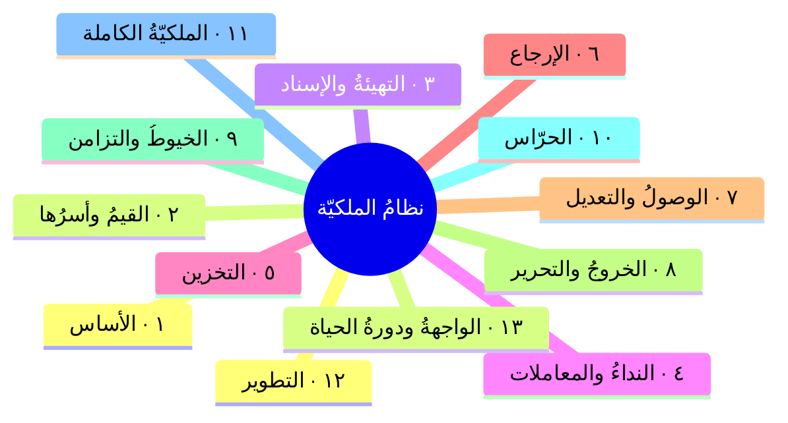

| # | المنطقة | ما تتناوله | الموضوعاتُ الرئيسة | الفروع | الأوراق | حالاتُ القائمة |
|---:|---|---|---:|---:|---:|---:|
| ١ | **الأساس** | القواعدُ والطبقتان والمواضعُ والثوابتُ التي يقوم عليها كلُّ ما بعدها | ٦ | ١٢ | ٥٤ | — |
| ٢ | **القيمُ وأُسرُها** | كلُّ نوعٍ في ص من أسرةٍ واحدة، وفهرسُ الأنواع بحسبها، وما يحسبه المترجم لكلّ نوع | ٨ | ٢١ | ١٠١ | ٥ |
| ٣ | **التهيئةُ والإسناد** | من أين تأتي القيمةُ إلى اسمٍ جديد أو قائم، ومتى، وبأيّ صيغة | ٩ | ٩ | ٣١ | ٢٤ |
| ٤ | **النداءُ والمعاملات** | ما يحدث للوسيط حين يُمرَّر: بحسب التوقيع والمستقبِل وصيغة النداء | ٨ | ١٤ | ٤٠ | ٢٧ |
| ٥ | **التخزين** | حيث تستقرّ القيمةُ خارج متغيّرٍ محلّيّ: حقلٌ، حاوية، مغلَق، صندوق، متغيّرٌ عامّ | ٨ | ٨ | ٣٥ | ١٧ |
| ٦ | **الإرجاع** | ما يخرج من الدالّة: بحسب مصدره وشكله وما يحمله | ٩ | ٨ | ٢٩ | ٢٣ |
| ٧ | **الوصولُ والتعديل** | القراءةُ والكتابةُ ومددُهما، وكيف تتقاطع | ٧ | ٦ | ٣٢ | ٣ |
| ٨ | **الخروجُ والتحرير** | متى تنتهي القيمة، وبأيّ طريق، وبأيّ ترتيب، وما يُنفَّذ عندها | ١١ | ٨ | ٤٢ | ١٥ |
| ٩ | **الخيوطُ والتزامن** | ما يعبر بين الخيوط، وما يُتقاسم، وما يُنتظر، والمهامُّ غيرُ المتزامنة | ٩ | ٦ | ٢٧ | ٤ |
| ١٠ | **الحرّاس** | ما يحرس القواعدَ وقتَ الترجمة ووقتَ التشغيل، وما يقع حين يُخرَق، وما يكلّفه | ٦ | ٨ | ٣٤ | — |
| ١١ | **الملكيّةُ الكاملة** | الكلماتُ الثلاث وما يلزمها: الأعمار، و«غير آمن»، والذرّيّ، وحدودُ المنصّة | ٦ | ٦ | ٢٥ | ٣ |
| ١٢ | **التطوير** | التحميلُ الحيّ والوضعان والأدوات التي تُظهر الملكيّةَ للمطوّر | ٥ | ٤ | ٢٠ | — |
| ١٣ | **الواجهةُ ودورةُ الحياة** | حالةُ الواجهة ومكوّناتُها، والاشتراكات، والتفاعليّة، ودورةُ حياة التطبيق على الهاتف | ٦ | ٨ | ١٩ | ٧ |
| | **المجموع** | | **٩٨** | **١١٨** | **٤٨٩** | **١٢٨** |

---

## ٢ · المناطقُ مخطّطاتٍ

### ١ · الأساس

> القواعدُ والطبقتان والمواضعُ والثوابتُ التي يقوم عليها كلُّ ما بعدها.

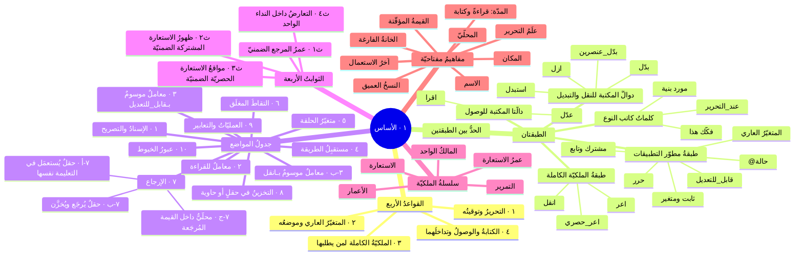

### ٢ · القيمُ وأُسرُها

> كلُّ نوعٍ في ص من أسرةٍ واحدة، وفهرسُ الأنواع بحسبها، وما يحسبه المترجم لكلّ نوع.

#### ٢‑أ · المنطقةُ دون «فهرسُ الأنواع»

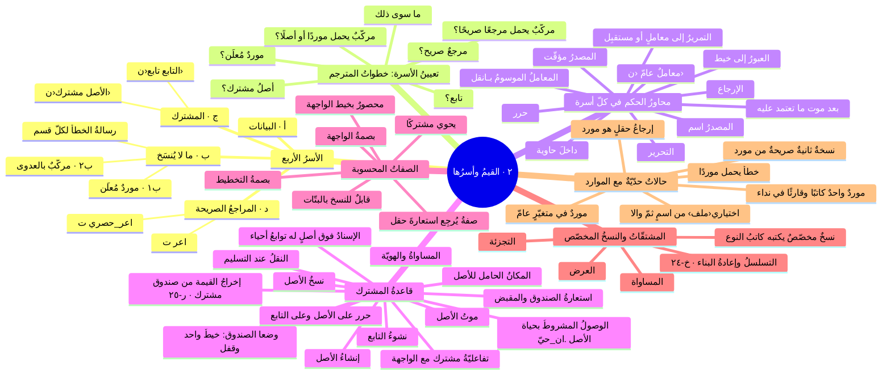

#### ٢‑ب · فهرسُ الأنواع

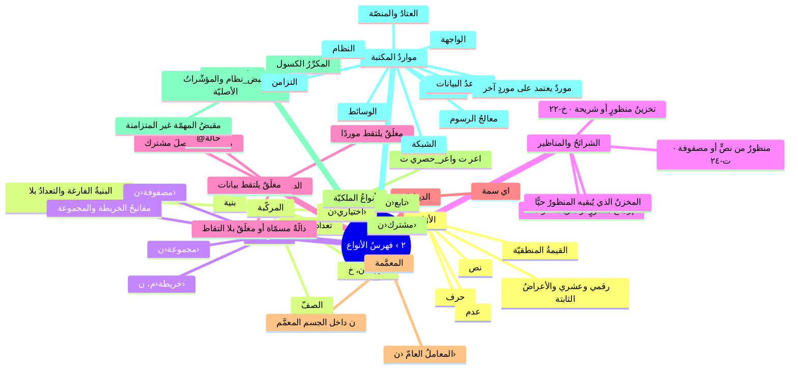

### ٣ · التهيئةُ والإسناد

> من أين تأتي القيمةُ إلى اسمٍ جديد أو قائم، ومتى، وبأيّ صيغة.

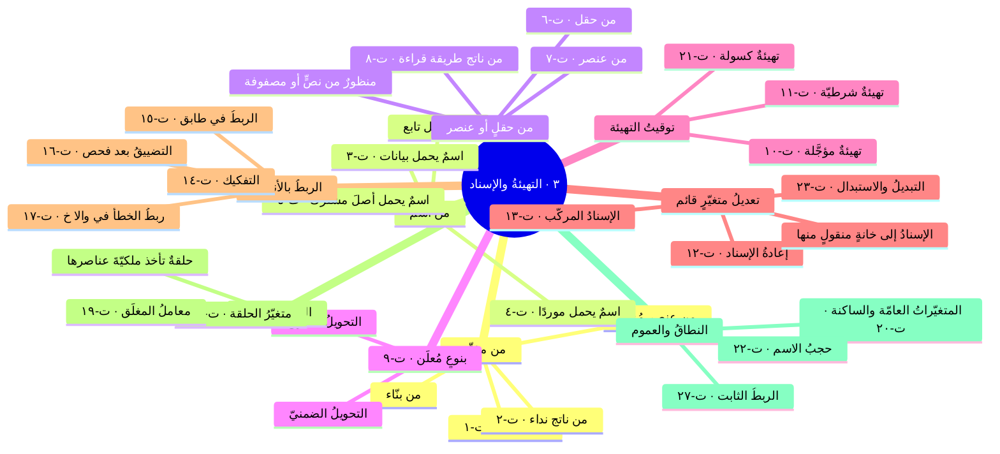

### ٤ · النداءُ والمعاملات

> ما يحدث للوسيط حين يُمرَّر: بحسب التوقيع والمستقبِل وصيغة النداء.

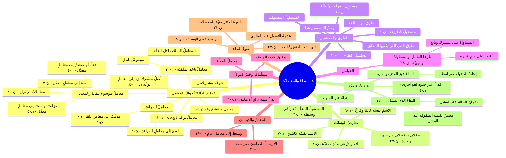

### ٥ · التخزين

> حيث تستقرّ القيمةُ خارج متغيّرٍ محلّيّ: حقلٌ، حاوية، مغلَق، صندوق، متغيّرٌ عامّ.

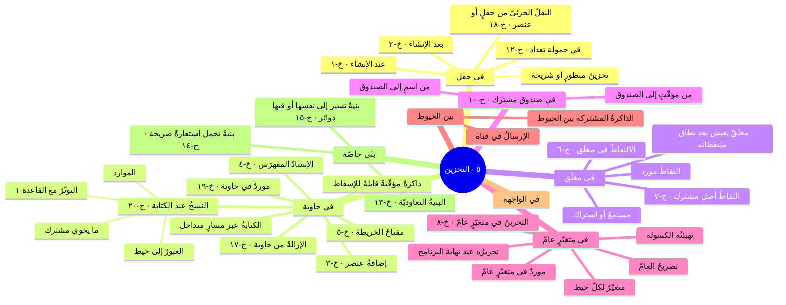

### ٦ · الإرجاع

> ما يخرج من الدالّة: بحسب مصدره وشكله وما يحمله.

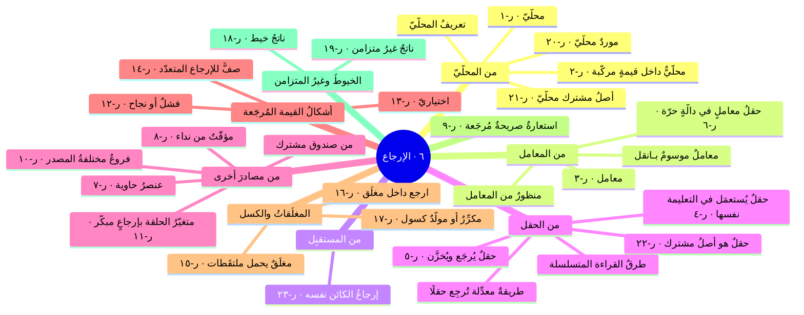

### ٧ · الوصولُ والتعديل

> القراءةُ والكتابةُ ومددُهما، وكيف تتقاطع.

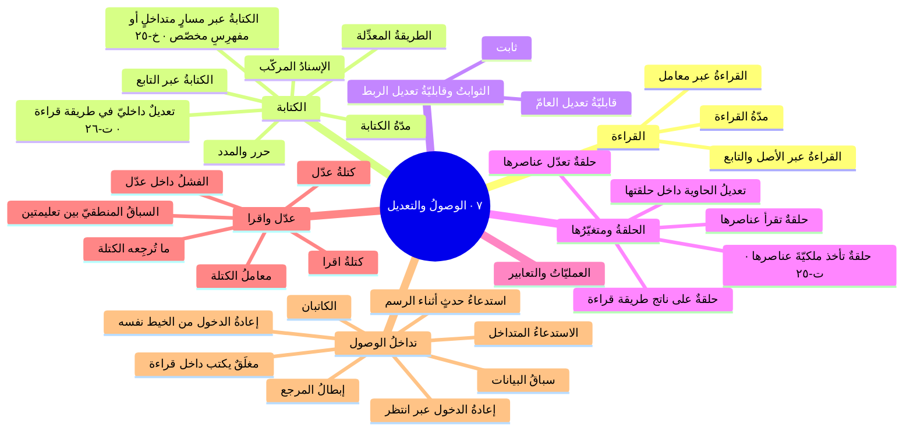

### ٨ · الخروجُ والتحرير

> متى تنتهي القيمة، وبأيّ طريق، وبأيّ ترتيب، وما يُنفَّذ عندها.

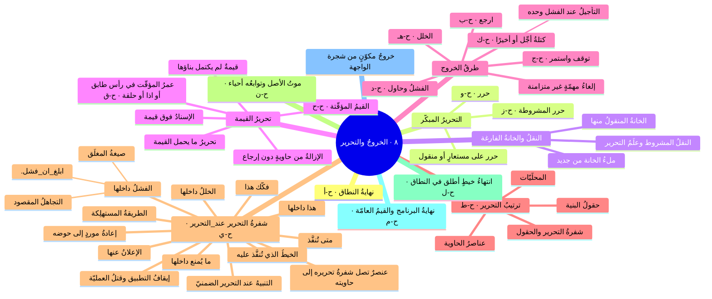

### ٩ · الخيوطُ والتزامن

> ما يعبر بين الخيوط، وما يُتقاسم، وما يُنتظر، والمهامُّ غيرُ المتزامنة.

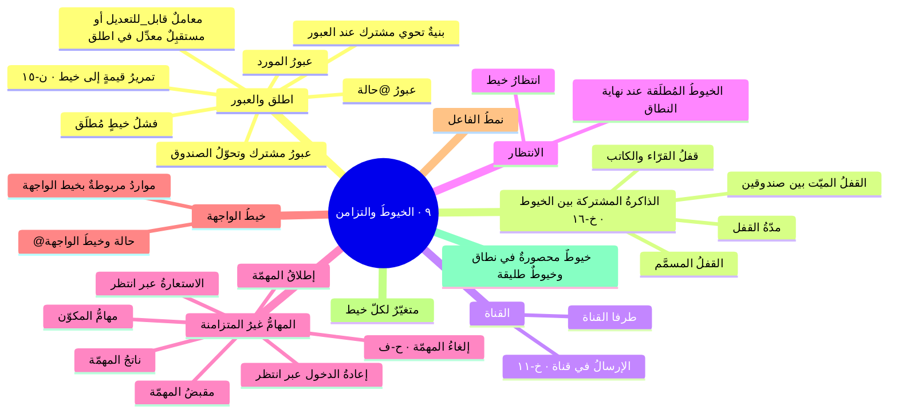

### ١٠ · الحرّاس

> ما يحرس القواعدَ وقتَ الترجمة ووقتَ التشغيل، وما يقع حين يُخرَق، وما يكلّفه.

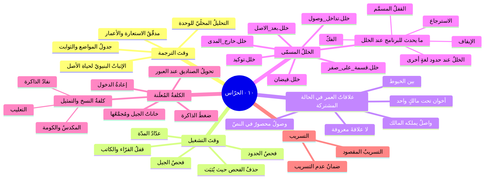

### ١١ · الملكيّةُ الكاملة

> الكلماتُ الثلاث وما يلزمها: الأعمار، و«غير آمن»، والذرّيّ، وحدودُ المنصّة.

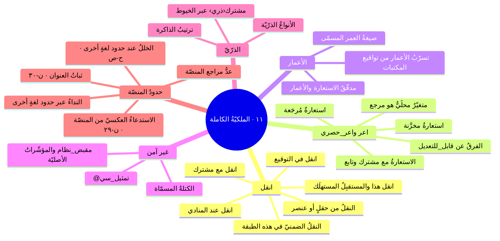

### ١٢ · التطوير

> التحميلُ الحيّ والوضعان والأدوات التي تُظهر الملكيّةَ للمطوّر.

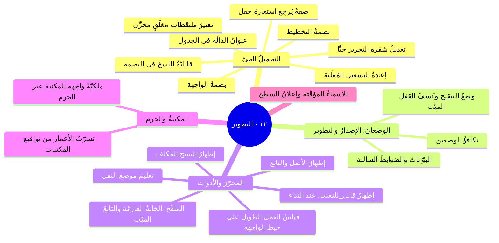

### ١٣ · الواجهةُ ودورةُ الحياة

> حالةُ الواجهة ومكوّناتُها، والاشتراكات، والتفاعليّة، ودورةُ حياة التطبيق على الهاتف.

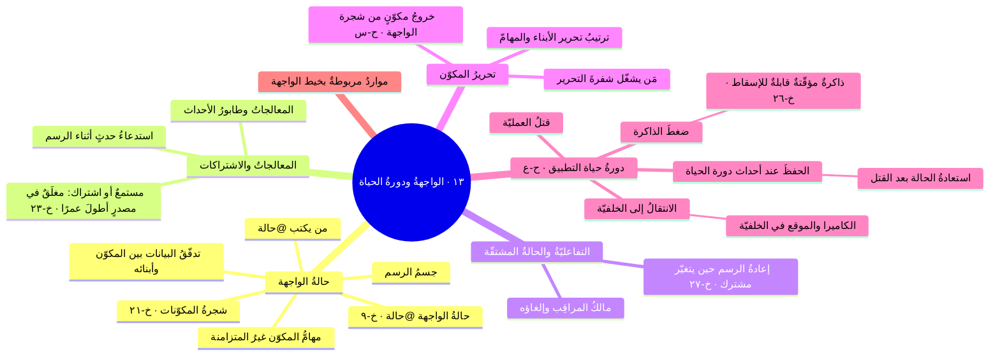

---

## ٣ · الشجرةُ نصًّا

### ١ · الأساس

- **القواعدُ الأربع** ١.١ · نظام الملكيّة › القرار
  - ١ · التحريرُ وتوقيتُه · ¶ نصُّه في §٥ (ق١) ١.١.١
  - ٢ · المتغيّرُ العاري وموضعُه · ¶ نصُّه في §٥ (ق٢) ١.١.٢
  - ٣ · الملكيّةُ الكاملة لمن يطلبها · ¶ نصُّه في §٥ (ق٣) ١.١.٣
  - ٤ · الكتابةُ والوصولُ وتداخلُهما · ¶ نصُّه في §٥ (ق٤) ١.١.٤ · نظام الملكيّة › القاعدة ٤
- **الطبقتان** ١.٢ · ملخّص نظام الذاكرة › ٤ · الكلمات
  - **طبقةُ مطوّر التطبيقات** ١.٢.١
    - المتغيّرُ العاري ١.٢.١.١
    - `قابل_للتعديل` ١.٢.١.٢
    - `مشترك` و`تابع` ١.٢.١.٣
    - `حرر` ١.٢.١.٤
    - `@حالة` ١.٢.١.٥
    - `ثابت` و`متغير` ١.٢.١.٦
  - **طبقةُ الملكيّة الكاملة** ١.٢.٢
    - _`انقل`_ ← انظر ١١ › انقل ‹١١.١› ١.٢.٢.١
    - _`اعر`_ ← انظر ١١ › اعر واعر_حصري ‹١١.٢› ١.٢.٢.٢
    - _`اعر_حصري`_ ← انظر ١١ › اعر واعر_حصري ‹١١.٢› ١.٢.٢.٣
  - **كلماتُ كاتب النوع** ١.٢.٣
    - `مورد بنية` ١.٢.٣.١
    - _`عند_التحرير`_ ← انظر `ح‑ي` ١.٢.٣.٢
    - _`فكّك هذا`_ ← انظر ٨ › شفرةُ التحرير عند_التحرير ‹٨.٧.٧› ١.٢.٣.٣
  - **دالّتا المكتبة للوصول** ١.٢.٤
    - _`عدّل`_ ← انظر ٧ › عدّل واقرا ‹٧.٦› ١.٢.٤.١
    - _`اقرا`_ ← انظر ٧ › عدّل واقرا ‹٧.٦› ١.٢.٤.٢
  - **دوالُّ المكتبة للنقل والتبديل** ١.٢.٥ · نظام الملكيّة › لوازمُ تتبع القواعدَ مباشرة
    - _`استبدل`_ ← انظر `خ‑١٨` ١.٢.٥.١
    - _`بدّل`_ ← انظر `ت‑٢٣` ١.٢.٥.٢
    - `بدّل_عنصرين` ١.٢.٥.٣
    - _`ازل`_ ← انظر `خ‑١٧` ١.٢.٥.٤
  - الحدُّ بين الطبقتين ١.٢.٦
- **جدولُ المواضع** ١.٣ · نظام الملكيّة › جدولُ المواضع
  - ١ · الإسنادُ والتصريح ١.٣.١
  - ٢ · معاملٌ للقراءة ١.٣.٢
  - ٣ · معاملٌ موسومٌ بـ`قابل_للتعديل` ١.٣.٣
  - ٣‑ب · معاملٌ موسومٌ بـ`انقل` ١.٣.٤ · نظام الملكيّة › الموضع ٣‑ب
  - ٤ · مستقبِلُ الطريقة ١.٣.٥
  - ٥ · متغيّرُ الحلقة ١.٣.٦
  - ٦ · التقاطُ المغلَق ١.٣.٧
  - **٧ · الإرجاع** ١.٣.٨
    - ٧‑أ · حقلٌ يُستعمَل في التعليمة نفسها ١.٣.٨.١
    - ٧‑ب · حقلٌ يُرجَع ويُخزَّن ١.٣.٨.٢
    - ٧‑ج · محلّيٌّ داخل القيمة المُرجَعة ١.٣.٨.٣
  - ٨ · التخزينُ في حقلٍ أو حاوية ١.٣.٩
  - ٩ · العمليّاتُ والتعابير ← انظر أيضًا `ن‑٢٨` ١.٣.١٠
  - ١٠ · عبورُ الخيوط ١.٣.١١
- **الثوابتُ الأربعة** ١.٤ · نظام الملكيّة › أربعةُ ثوابتَ تجعل المواضعَ آمنة
  - ث١ · عمرُ المرجع الضمنيّ ← انظر أيضًا `ر‑١٧` ← انظر أيضًا `ت‑٢٤` · ¶ نصُّه في §٥ (ث١) ١.٤.١
  - ث٢ · ظهورُ الاستعارة المشتركة الضمنيّة · ¶ نصُّه في §٥ (ث٢) ١.٤.٢
  - ث٣ · مواقعُ الاستعارة الحصريّة الضمنيّة · ¶ نصُّه في §٥ (ث٣) ١.٤.٣
  - ث٤ · التعارضُ داخل النداء الواحد ← انظر أيضًا `ن‑٦` ← انظر أيضًا `ن‑٢٦` ← انظر أيضًا `ن‑٢٧` · ¶ نصُّه في §٥ (ث٤) ١.٤.٤
- **سلسلةُ الملكيّة** ١.٥
  - المالكُ الواحد ١.٥.١
  - التمرير ١.٥.٢
  - الاستعارة ١.٥.٣
  - عمرُ الاستعارة ١.٥.٤
  - الأعمار ← انظر أيضًا ١١ › الأعمار ‹١١.٣› ١.٥.٥
- **مفاهيمُ مفتاحيّة** ١.٦
  - القيمةُ المؤقّتة ١.٦.١
  - الاسم ١.٦.٢
  - المكان ١.٦.٣
  - المحلّيّ ١.٦.٤
  - المدّة: قراءةً وكتابة ١.٦.٥
  - آخرُ الاستعمال ١.٦.٦
  - الخانةُ الفارغة ← انظر أيضًا ٨ › النقلُ والخانةُ الفارغة ‹٨.٣› ١.٦.٧
  - علَمُ التحرير ١.٦.٨
  - النسخُ العميق ١.٦.٩

### ٢ · القيمُ وأُسرُها

- **الأُسرُ الأربع** ٢.١ · تصنيف أنواع البيانات › ١ · أسرُ الملكيّة الأربع
  - أ · البيانات ٢.١.١
  - **ب · ما لا يُنسَخ** ٢.١.٢
    - ب١ · موردٌ مُعلَن ٢.١.٢.١
    - ب٢ · مركّبٌ بالعدوى ٢.١.٢.٢
    - رسالةُ الخطأ لكلّ قسم ٢.١.٢.٣
  - **ج · المشترك** ٢.١.٣
    - الأصل `مشترك<ن>` ٢.١.٣.١
    - التابع `تابع<ن>` ٢.١.٣.٢
  - **د · المراجعُ الصريحة** ٢.١.٤
    - `اعر ت` ٢.١.٤.١
    - `اعر_حصري ت` ٢.١.٤.٢
- **تعيينُ الأسرة: خطواتُ المترجم** ٢.٢ · تصنيف أنواع البيانات › ٢ · كيف يُعرَف نوعٌ من أيّ أسرة
  - مرجعٌ صريح؟ ٢.٢.١
  - أصلُ `مشترك`؟ ٢.٢.٢
  - `تابع`؟ ٢.٢.٣
  - موردٌ مُعلَن؟ ٢.٢.٤
  - مركّبٌ يحمل مرجعًا صريحًا؟ ٢.٢.٥
  - مركّبٌ يحمل موردًا أو أصلًا؟ ٢.٢.٦
  - ما سوى ذلك ٢.٢.٧
- **محاورُ الحكم في كلّ أسرة** ٢.٣ · تصنيف أنواع البيانات › ٣ · قواعدُ كلّ أسرة
  - المصدرُ مؤقّت ٢.٣.١
  - المصدرُ اسم ٢.٣.٢
  - التمريرُ إلى معاملٍ أو مستقبِل ٢.٣.٣
  - _المعاملُ الموسومُ بـ`انقل`_ ← انظر ١ › جدولُ المواضع ‹١.٣.٤› ٢.٣.٤
  - الإرجاع ٢.٣.٥
  - التحرير ٢.٣.٦
  - `حرر` ٢.٣.٧
  - العبورُ إلى خيط ٢.٣.٨
  - داخلَ حاوية ٢.٣.٩
  - معاملٌ عامّ `<ن>` ٢.٣.١٠
  - بعد موت ما تعتمد عليه ٢.٣.١١
- **قاعدةُ المشترك** ٢.٤ · نظام الملكيّة › قاعدةُ مشترك
  - إنشاءُ الأصل ٢.٤.١
  - نشوءُ التابع ٢.٤.٢
  - نسخُ الأصل ٢.٤.٣
  - المكانُ الحامل للأصل ٢.٤.٤
  - استعارةُ الصندوق والمقبض ٢.٤.٥
  - النقلُ عند التسليم ٢.٤.٦
  - وضعا الصندوق: خيطٌ واحد وقفل ٢.٤.٧
  - `حرر` على الأصل وعلى التابع ٢.٤.٨
  - الإسنادُ فوق أصلٍ له توابعُ أحياء ٢.٤.٩
  - الوصولُ المشروطُ بحياة الأصل `.ان_حيّ` ٢.٤.١٠ · تصنيف أنواع البيانات › ٧ · شفرةُ التحرير، البند ٤
  - إخراجُ القيمة من صندوق `مشترك` `ر‑٢٥` ٢.٤.١١
  - _المساواةُ والهويّة_ ← انظر `ن‑٢٨` ٢.٤.١٢
  - _تفاعليّةُ `مشترك` مع الواجهة_ ← انظر `خ‑٢٧` ٢.٤.١٣
  - _موتُ الأصل_ ← انظر `ح‑ن` ٢.٤.١٤
- **فهرسُ الأنواع** ٢.٥ · تصنيف أنواع البيانات › ٤ · فهرسُ الأنواع وأُسرُها
  - **الأوّليّة** ٢.٥.١ · تصنيف أنواع البيانات › ٤‑أ
    - `رقمي` و`عشري` والأعراضُ الثابتة ٢.٥.١.١
    - القيمةُ المنطقيّة ٢.٥.١.٢
    - `حرف` ٢.٥.١.٣
    - `نص` ٢.٥.١.٤
    - `عدم` ٢.٥.١.٥
  - **المركّبة** ٢.٥.٢ · تصنيف أنواع البيانات › ٤‑ب
    - `بنية` ٢.٥.٢.١
    - البنيةُ الفارغة والتعدادُ بلا حمولة ٢.٥.٢.٢
    - `تعداد` بحمولة ٢.٥.٢.٣
    - الصفّ ٢.٥.٢.٤
    - `اختياري<ن>` ٢.٥.٢.٥
    - `نتيجة<ن، خ>` ٢.٥.٢.٦
  - **الحاويات** ٢.٥.٣
    - `مصفوفة<ن>` ٢.٥.٣.١
    - `خريطة<م، ن>` ٢.٥.٣.٢
    - `مجموعة<ن>` ٢.٥.٣.٣
    - _مفاتيحُ الخريطة والمجموعة_ ← انظر `خ‑٥` ٢.٥.٣.٤
  - **الشرائحُ والمناظير** ٢.٥.٤
    - منظورٌ من نصٍّ أو مصفوفة `ت‑٢٤` ٢.٥.٤.١
    - تخزينُ منظورٍ أو شريحة `خ‑٢٢` ٢.٥.٤.٢
    - إرجاعُ منظورٍ أو شريحة `ر‑٢٤` ٢.٥.٤.٣
    - المخزنُ الذي يُبقيه المنظورُ حيًّا ٢.٥.٤.٤
  - **الدوالُّ والمغلَقات** ٢.٥.٥ · تصنيف أنواع البيانات › ٤‑ج
    - دالّةٌ مسمّاة أو مغلَقٌ بلا التقاط ٢.٥.٥.١
    - مغلَقٌ يلتقط بيانات ٢.٥.٥.٢
    - _مغلَقٌ يلتقط أصلَ `مشترك`_ ← انظر `خ‑٧` ٢.٥.٥.٣
    - _مغلَقٌ يلتقط موردًا_ ← انظر ٥ › في مغلَق ‹٥.٣.٣› ٢.٥.٥.٤
    - `@حالة` ← انظر أيضًا `خ‑٩` ٢.٥.٥.٥
  - **الديناميّة** ٢.٥.٦ · تصنيف أنواع البيانات › ٤‑د
    - `اي سمة` ← انظر أيضًا `ن‑٢١` ٢.٥.٦.١
  - **المعمَّمة** ٢.٥.٧
    - المعاملُ العامّ `<ن>` ← انظر أيضًا `ن‑١٩` ٢.٥.٧.١
    - `ن` داخل الجسم المعمَّم ٢.٥.٧.٢
  - **أنواعُ الملكيّة** ٢.٥.٨ · تصنيف أنواع البيانات › ٤‑هـ
    - `مشترك<ن>` ٢.٥.٨.١
    - `تابع<ن>` ٢.٥.٨.٢
    - `اعر ت` و`اعر_حصري ت` ٢.٥.٨.٣
  - **أنواعٌ خاصّة** ٢.٥.٩ · تصنيف أنواع البيانات › ٤‑ز
    - _الأنواعُ الذرّيّة_ ← انظر ١١ › الذرّيّ ‹١١.٥.١› ٢.٥.٩.١
    - _المكرِّرُ الكسول_ ← انظر `ر‑١٧` ٢.٥.٩.٢
    - _مقبضُ المهمّة غير المتزامنة_ ← انظر ٩ › المهامُّ غيرُ المتزامنة ‹٩.٥.٥› ٢.٥.٩.٣
    - _`مقبض_نظام` والمؤشّراتُ الأصليّة_ ← انظر ١١ › «غير آمن» ‹١١.٤.٢› ٢.٥.٩.٤
  - **مواردُ المكتبة** ٢.٥.١٠ · تصنيف أنواع البيانات › ٤‑و
    - الملفّات ٢.٥.١٠.١
    - الشبكة ٢.٥.١٠.٢
    - قواعدُ البيانات ٢.٥.١٠.٣
    - التزامن ٢.٥.١٠.٤
    - الواجهة ٢.٥.١٠.٥
    - الوسائط ٢.٥.١٠.٦
    - العتادُ والمنصّة ٢.٥.١٠.٧
    - معالجُ الرسوم ٢.٥.١٠.٨
    - النظام ٢.٥.١٠.٩
    - موردٌ يعتمد على موردٍ آخر ٢.٥.١٠.١٠
- **الصفاتُ المحسوبة** ٢.٦ · نظام الأنواع › ٢‑٨ · صفاتٌ يحسبها المترجم
  - قابلٌ للنسخ بالبتّات ٢.٦.١
  - يحوي مشتركًا ٢.٦.٢
  - محصورٌ بخيط الواجهة ٢.٦.٣
  - بصمةُ التخطيط ٢.٦.٤
  - _صفةُ «يُرجِع استعارةَ حقل»_ ← انظر ١٢ › التحميلُ الحيّ ‹١٢.١.٢› ٢.٦.٥
  - _بصمةُ الواجهة_ ← انظر ١٢ › التحميلُ الحيّ ‹١٢.١.١› ٢.٦.٦
- **المشتقّاتُ والنسخُ المخصّص** ٢.٧ · نظام الأنواع › ٢‑٨ · المشتقّاتُ التلقائيّة
  - المساواة ٢.٧.١
  - التجزئة ٢.٧.٢
  - العرض ٢.٧.٣
  - التسلسلُ وإعادةُ البناء `خ‑٢٤` ٢.٧.٤
  - نسخٌ مخصّصٌ يكتبه كاتبُ النوع ٢.٧.٥
- **حالاتٌ حدّيّةٌ مع الموارد** ٢.٨ · تصنيف أنواع البيانات › ٤‑ح · حالاتٌ حدّيّة مع الموارد
  - موردٌ في متغيّرٍ عامّ ← انظر أيضًا `خ‑٨` ٢.٨.١
  - _إرجاعُ حقلٍ هو مورد_ ← انظر `ر‑٤` ← انظر `ر‑٥` ٢.٨.٢
  - _موردٌ واحدٌ كاتبًا وقارئًا في نداء_ ← انظر `ن‑٦` ٢.٨.٣
  - `اختياري<ملف>` من اسمٍ ثمّ `والا` ٢.٨.٤
  - خطأٌ يحمل موردًا ٢.٨.٥
  - نسخةٌ ثانيةٌ صريحةٌ من مورد ٢.٨.٦

### ٣ · التهيئةُ والإسناد

- **من مؤقّت** ٣.١ · قائمة تدفّق القيم › ١‑أ · التهيئةُ من قيمة
  - من حرفيّة `ت‑١` ٣.١.١
  - من ناتج نداء `ت‑٢` ٣.١.٢
  - _من بنّاء_ ← انظر `ن‑١٠` ٣.١.٣
  - _من عنصرٍ مُزال_ ← انظر `خ‑١٧` ٣.١.٤
- **من اسم** ٣.٢ · قائمة تدفّق القيم › ١‑أ · التهيئةُ من قيمة
  - اسمٌ يحمل بيانات `ت‑٣` ٣.٢.١
  - اسمٌ يحمل موردًا `ت‑٤` ٣.٢.٢
  - اسمٌ يحمل أصلَ `مشترك` `ت‑٥` ٣.٢.٣
  - اسمٌ يحمل `تابع` ٣.٢.٤
- **من حقلٍ أو عنصر** ٣.٣ · قائمة تدفّق القيم › ١‑أ · التهيئةُ من قيمة
  - من حقل `ت‑٦` ٣.٣.١
  - من عنصر `ت‑٧` ٣.٣.٢
  - من ناتج طريقة قراءة `ت‑٨` ٣.٣.٣
  - _منظورٌ من نصٍّ أو مصفوفة_ ← انظر `ت‑٢٤` ٣.٣.٤
- **بنوعٍ مُعلَن** `ت‑٩` ٣.٤ · قائمة تدفّق القيم › ١‑ب · التهيئةُ بنوعٍ مُعلَن
  - التحويلُ الضمنيّ ٣.٤.١
  - التحويلُ الصريح ٣.٤.٢
- **توقيتُ التهيئة** ٣.٥ · قائمة تدفّق القيم › ١‑ج · توقيتُ التهيئة
  - تهيئةٌ مؤجَّلة `ت‑١٠` ٣.٥.١
  - تهيئةٌ شرطيّة `ت‑١١` ٣.٥.٢
  - تهيئةٌ كسولة `ت‑٢١` ← انظر أيضًا `خ‑٨` ٣.٥.٣
- **تعديلُ متغيّرٍ قائم** ٣.٦ · قائمة تدفّق القيم › ١‑د · تعديلُ متغيّرٍ قائم
  - إعادةُ الإسناد `ت‑١٢` ٣.٦.١
  - الإسنادُ المركّب `ت‑١٣` ٣.٦.٢
  - التبديلُ والاستبدال `ت‑٢٣` ٣.٦.٣
  - _الإسنادُ إلى خانةٍ منقولٍ منها_ ← انظر ٨ › النقلُ والخانةُ الفارغة ‹٨.٣.٣› ٣.٦.٤
- **الربطُ بالأنماط** ٣.٧ · قائمة تدفّق القيم › ١‑هـ · الربطُ بالأنماط
  - التفكيك `ت‑١٤` ٣.٧.١
  - الربطُ في `طابق` `ت‑١٥` ٣.٧.٢
  - التضييقُ بعد فحص `ت‑١٦` ٣.٧.٣
  - ربطُ الخطأ في `والا خ` `ت‑١٧` ٣.٧.٤
- **الربطُ الضمنيّ** ٣.٨ · قائمة تدفّق القيم › ١‑و · الربطُ الضمنيّ
  - متغيّرُ الحلقة `ت‑١٨` ٣.٨.١
  - معاملُ المغلَق `ت‑١٩` ٣.٨.٢
  - _حلقةٌ تأخذ ملكيّةَ عناصرها_ ← انظر `ت‑٢٥` ٣.٨.٣
- **النطاقُ والعموم** ٣.٩ · قائمة تدفّق القيم › ١‑ز · النطاقُ والعموم
  - المتغيّراتُ العامّة والساكنة `ت‑٢٠` ← انظر أيضًا `خ‑٨` ٣.٩.١
  - حجبُ الاسم `ت‑٢٢` ٣.٩.٢
  - الربطُ الثابت `ت‑٢٧` ٣.٩.٣

### ٤ · النداءُ والمعاملات

- **توقيعُ الدالّة: أحوالُ المعامل** ٤.١ · قائمة تدفّق القيم › ٢ · النداء
  - **معاملٌ للقراءة** ٤.١.١
    - اسمٌ إلى معاملٍ للقراءة `ن‑١` ٤.١.١.١
    - مؤقّتٌ إلى معاملٍ للقراءة `ن‑٢` ٤.١.١.٢
  - **معاملٌ موسومٌ بـ`قابل_للتعديل`** ٤.١.٢
    - اسمٌ إلى معاملٍ معدِّل `ن‑٣` ٤.١.٢.١
    - حقلٌ أو عنصرٌ إلى معاملٍ معدِّل `ن‑٤` ٤.١.٢.٢
    - مؤقّتٌ أو ثابتٌ إلى معاملٍ معدِّل `ن‑٥` ٤.١.٢.٣
    - معاملاتُ الإخراج `ن‑٢٥` ٤.١.٢.٤
  - **معاملٌ يأخذ الملكيّة** `ن‑١٢` ٤.١.٣
    - _موسومٌ بـ`انقل`_ ← انظر ١ › جدولُ المواضع ‹١.٣.٤› ٤.١.٣.١
    - نوعُه `مشترك<ن>` ٤.١.٣.٢
    - المعاملُ المالك داخل الدالّة ٤.١.٣.٣
  - معاملٌ نوعُه `تابع<ن>` `ن‑١٣` ٤.١.٤
  - أصلُ `مشترك<ن>` إلى معاملٍ نوعُه `ن` `ن‑١٤` ٤.١.٥
  - معاملٌ لا يُنسَخ ولم يُوسَم ٤.١.٦
- **تعارضُ الوسائط** ٤.٢ · نظام الملكيّة › أربعةُ ثوابتَ تجعل المواضعَ آمنة
  - الاسمُ نفسُه كاتبًا وقارئًا `ن‑٦` ٤.٢.١
  - الاسمُ نفسُه كاتبَين `ن‑٧` ٤.٢.٢
  - التعارضُ في مدّةٍ ممتدّة `ن‑٨` ٤.٢.٣
  - المستقبِلُ المعدَّل يُقرأ في وسيطه `ن‑٢٦` ٤.٢.٤
  - حقلان منفصلان من بنيةٍ واحدة `ن‑٢٧` ٤.٢.٥
- **الطرقُ والمستقبِل** ٤.٣
  - مستقبِلُ الطريقة `ن‑٩` ٤.٣.١
  - المستقبِلُ المؤقّت والبنّاء `ن‑١٠` ٤.٣.٢
  - تسلسلُ الطرق `ن‑١١` ٤.٣.٣
  - طرقُ أنواع اللغة ٤.٣.٤
  - طرقُ البنى التي يكتبها المطوّر ٤.٣.٥
  - وسمُ المستقبِل `هذا` ٤.٣.٦
  - _المستقبِلُ المستهلَك_ ← انظر ١١ › انقل ‹١١.١.٣› ٤.٣.٧
- **العوامل** ٤.٤
  - **طرفا العامل، والمساواةُ والهويّة** `ن‑٢٨` ٤.٤.١
    - `أ + ب` على قيمٍ كبيرة ٤.٤.١.١
    - المساواةُ على `مشترك` و`تابع` ٤.٤.١.٢
- **المغلَقاتُ وقيمُ الدوالّ** ٤.٥
  - نداءُ قيمةِ دالّةٍ أو مغلَق `ن‑٢٠` ٤.٥.١
  - _معاملُ المغلَق_ ← انظر `ت‑١٩` ٤.٥.٢
  - _مغلَقٌ تناديه المنصّة_ ← انظر `ن‑٢٩` ٤.٥.٣
- **المعمَّمُ والديناميّ** ٤.٦
  - وسيطٌ إلى معاملٍ عامّ `ن‑١٩` ٤.٦.١
  - الإرسالُ الديناميّ عبر سمة `ن‑٢١` ٤.٦.٢
- **صيغُ النداء** ٤.٧
  - ترتيبُ تقييم الوسائط `ن‑١٨` ٤.٧.١
  - الوسائطُ المتغيّرةُ العدد `ن‑٢٢` ٤.٧.٢
  - القيمُ الافتراضيّة للمعاملات `ن‑٢٣` ٤.٧.٣
  - علامةُ التعديل عند المنادي ٤.٧.٤
- **نداءاتٌ خاصّة** ٤.٨
  - **النداءُ الذي يفشل** `ن‑١٧` ٤.٨.١ · DECISIONS.md › الفشل › (أ) الفشلُ المتوقَّع
    - ضمانُ الحالة عند الفشل ٤.٨.١.١
    - مصيرُ القيمة المنقولة عند الفشل ٤.٨.١.٢
  - **النداءُ غيرُ المتزامن** `ن‑١٦` ٤.٨.٢
    - _إعادةُ الدخول عبر `انتظر`_ ← انظر ٩ › المهامُّ غيرُ المتزامنة ‹٩.٥.٧› ٤.٨.٢.١
  - النداءُ عبر حدود لغةٍ أخرى `ن‑٢٤` ٤.٨.٣
  - _النداءُ عبر الخيوط_ ← انظر `ن‑١٥` ٤.٨.٤

### ٥ · التخزين

- **في حقل** ٥.١ · قائمة تدفّق القيم › ٣ · التخزين
  - عند الإنشاء `خ‑١` ٥.١.١
  - بعد الإنشاء `خ‑٢` ٥.١.٢
  - في حمولة تعداد `خ‑١٢` ٥.١.٣
  - النقلُ الجزئيّ من حقلٍ أو عنصر `خ‑١٨` ٥.١.٤
  - _تخزينُ منظورٍ أو شريحة_ ← انظر `خ‑٢٢` ٥.١.٥
- **في حاوية** ٥.٢
  - إضافةُ عنصر `خ‑٣` ٥.٢.١
  - الإسنادُ المفهرَس `خ‑٤` ٥.٢.٢
  - _الكتابةُ عبر مسارٍ متداخل_ ← انظر `خ‑٢٥` ٥.٢.٣
  - مفتاحُ الخريطة `خ‑٥` ٥.٢.٤
  - الإزالةُ من حاوية `خ‑١٧` ٥.٢.٥
  - موردٌ في حاوية `خ‑١٩` ٥.٢.٦
  - **النسخُ عند الكتابة** `خ‑٢٠` ٥.٢.٧ · نظام الأنواع › ٤ · أسئلةٌ للمالك
    - ما يحوي `مشترك` ٥.٢.٧.١
    - العبورُ إلى خيط ٥.٢.٧.٢
    - الموارد ٥.٢.٧.٣
    - التوتّرُ مع القاعدة ١ ٥.٢.٧.٤
  - _ذاكرةٌ مؤقّتةٌ قابلةٌ للإسقاط_ ← انظر `خ‑٢٦` ٥.٢.٨
- **في مغلَق** ٥.٣
  - الالتقاطُ في مغلَق `خ‑٦` ٥.٣.١
  - التقاطُ أصلِ `مشترك` `خ‑٧` ٥.٣.٢
  - التقاطُ مورد ٥.٣.٣
  - مغلَقٌ يعيش بعد نطاق ملتقَطاته ٥.٣.٤
  - _مستمعٌ أو اشتراك_ ← انظر `خ‑٢٣` ٥.٣.٥
- **في صندوق `مشترك`** `خ‑١٠` ٥.٤
  - من مؤقّتٍ إلى الصندوق ٥.٤.١
  - من اسمٍ إلى الصندوق ٥.٤.٢
- **في متغيّرٍ عامّ** ٥.٥
  - التخزينُ في متغيّرٍ عامّ `خ‑٨` ٥.٥.١
  - _تصريحُ العامّ_ ← انظر `ت‑٢٠` ٥.٥.٢
  - _تهيئتُه الكسولة_ ← انظر `ت‑٢١` ٥.٥.٣
  - _موردٌ في متغيّرٍ عامّ_ ← انظر ٢ › حالاتٌ حدّيّةٌ مع الموارد ‹٢.٨.١› ٥.٥.٤
  - _تحريرُه عند نهاية البرنامج_ ← انظر `ح‑م` ٥.٥.٥
  - _متغيّرٌ لكلّ خيط_ ← انظر ٩ › متغيّرٌ لكلّ خيط ‹٩.٨› ٥.٥.٦
- **بين الخيوط** ٥.٦
  - _الإرسالُ في قناة_ ← انظر `خ‑١١` ٥.٦.١
  - _الذاكرةُ المشتركة بين الخيوط_ ← انظر `خ‑١٦` ٥.٦.٢
- _في الواجهة_ ← انظر `خ‑٩` ← انظر `خ‑٢١` ٥.٧
- **بنًى خاصّة** ٥.٨
  - البنيةُ التعاوديّة `خ‑١٣` ٥.٨.١
  - بنيةٌ تشير إلى نفسها أو فيها دوائر `خ‑١٥` ٥.٨.٢
  - بنيةٌ تحمل استعارةً صريحة `خ‑١٤` ٥.٨.٣

### ٦ · الإرجاع

- **من المحلّيّ** ٦.١ · قائمة تدفّق القيم › ٤ · الإرجاع
  - محلّيّ `ر‑١` ٦.١.١
  - محلّيٌّ داخل قيمةٍ مركّبة `ر‑٢` ٦.١.٢
  - موردٌ محلّيّ `ر‑٢٠` ٦.١.٣
  - أصلُ `مشترك` محلّيّ `ر‑٢١` ٦.١.٤
  - _تعريفُ «المحلّيّ»_ ← انظر ١ › مفاهيمُ مفتاحيّة ‹١.٦.٤› ٦.١.٥
- **من المعامل** ٦.٢
  - معامل `ر‑٣` ٦.٢.١
  - حقلُ معاملٍ في دالّةٍ حرّة `ر‑٦` ٦.٢.٢
  - _معاملٌ موسومٌ بـ`انقل`_ ← انظر ١ › جدولُ المواضع ‹١.٣.٤› ٦.٢.٣
  - _منظورٌ من المعامل_ ← انظر `ر‑٢٤` ٦.٢.٤
- **من المستقبِل** ٦.٣
  - إرجاعُ الكائن نفسه `ر‑٢٣` ← انظر أيضًا `ن‑١٠` ٦.٣.١
- **من الحقل** ٦.٤ · نظام الملكيّة › الموضع ٧ · إرجاعُ الحقل
  - حقلٌ يُستعمَل في التعليمة نفسها `ر‑٤` ٦.٤.١
  - حقلٌ يُرجَع ويُخزَّن `ر‑٥` ٦.٤.٢
  - حقلٌ هو أصلُ `مشترك` `ر‑٢٢` ٦.٤.٣
  - _طرقُ القراءة المتسلسلة_ ← انظر `ن‑١١` ٦.٤.٤
  - طريقةٌ معدِّلة تُرجِع حقلًا ٦.٤.٥
- **من مصادرَ أخرى** ٦.٥
  - عنصرُ حاوية `ر‑٧` ٦.٥.١
  - مؤقّتٌ من نداء `ر‑٨` ٦.٥.٢
  - متغيّرُ الحلقة بإرجاعٍ مبكّر `ر‑١١` ٦.٥.٣
  - فروعٌ مختلفةُ المصدر `ر‑١٠` ٦.٥.٤
  - _من صندوق `مشترك`_ ← انظر `ر‑٢٥` ٦.٥.٥
- **أشكالُ القيمة المُرجَعة** ٦.٦
  - فشلٌ أو نجاح `ر‑١٢` ٦.٦.١
  - اختياريّ `ر‑١٣` ٦.٦.٢
  - صفٌّ للإرجاع المتعدّد `ر‑١٤` ٦.٦.٣
- **المغلَقاتُ والكسل** ٦.٧
  - مغلَقٌ يحمل ملتقَطات `ر‑١٥` ٦.٧.١
  - `ارجع` داخل مغلَق `ر‑١٦` ٦.٧.٢
  - مكرِّرٌ أو مولّدٌ كسول `ر‑١٧` ٦.٧.٣
- استعارةٌ صريحةٌ مُرجَعة `ر‑٩` ٦.٨
- **الخيوطُ وغيرُ المتزامن** ٦.٩
  - ناتجُ خيط `ر‑١٨` ٦.٩.١
  - ناتجٌ غيرُ متزامن `ر‑١٩` ٦.٩.٢

### ٧ · الوصولُ والتعديل

- **القراءة** ٧.١
  - مدّةُ القراءة ٧.١.١
  - _القراءةُ عبر معامل_ ← انظر `ن‑١` ٧.١.٢
  - القراءةُ عبر الأصل والتابع ٧.١.٣
- **الكتابة** ٧.٢
  - مدّةُ الكتابة ٧.٢.١
  - الطريقةُ المعدِّلة ٧.٢.٢
  - _الإسنادُ المركّب_ ← انظر `ت‑١٣` ٧.٢.٣
  - الكتابةُ عبر التابع ٧.٢.٤
  - `حرر` والمدد ٧.٢.٥
  - تعديلٌ داخليّ في طريقة قراءة `ت‑٢٦` ٧.٢.٦
  - الكتابةُ عبر مسارٍ متداخلٍ أو مفهرِسٍ مخصّص `خ‑٢٥` ٧.٢.٧
- **الثوابتُ وقابليّةُ تعديل الربط** ٧.٣ · خارطة الطريق › المرحلة ٣ · قواعدُ التهيئة
  - `ثابت` ٧.٣.١
  - _قابليّةُ تعديل العامّ_ ← انظر `خ‑٨` ٧.٣.٢
- **الحلقةُ ومتغيّرُها** ٧.٤ · نظام الملكيّة › متغيّرُ الحلقة
  - حلقةٌ تقرأ عناصرها ٧.٤.١
  - حلقةٌ تعدّل عناصرها ٧.٤.٢
  - حلقةٌ تأخذ ملكيّةَ عناصرها `ت‑٢٥` ٧.٤.٣
  - تعديلُ الحاوية داخل حلقتها ٧.٤.٤
  - حلقةٌ على ناتج طريقة قراءة ٧.٤.٥
- _العمليّاتُ والتعابير_ ← انظر `ن‑٢٨` ٧.٥
- **`عدّل` و`اقرا`** ٧.٦ · ملخّص نظام الذاكرة › دالّتان في المكتبة
  - كتلةُ `عدّل` ٧.٦.١
  - كتلةُ `اقرا` ٧.٦.٢
  - معاملُ الكتلة ٧.٦.٣
  - الفشلُ داخل `عدّل` ٧.٦.٤ · DECISIONS.md › الفشل › (أ) الفشلُ المتوقَّع
  - ما تُرجِعه الكتلة ٧.٦.٥
  - السباقُ المنطقيّ بين تعليمتين ٧.٦.٦
- **تداخلُ الوصول** ٧.٧ · نظام الملكيّة › الحالةُ المشتركة القابلة للتعديل
  - إبطالُ المرجع ٧.٧.١
  - الاستدعاءُ المتداخل ٧.٧.٢
  - سباقُ البيانات ٧.٧.٣
  - الكاتبان ٧.٧.٤
  - إعادةُ الدخول من الخيط نفسه ٧.٧.٥
  - _إعادةُ الدخول عبر `انتظر`_ ← انظر ٩ › المهامُّ غيرُ المتزامنة ‹٩.٥.٧› ٧.٧.٦
  - استدعاءُ حدثٍ أثناء الرسم ٧.٧.٧
  - مغلَقٌ يكتب داخل قراءة ٧.٧.٨

### ٨ · الخروجُ والتحرير

- نهايةُ النطاق `ح‑أ` ٨.١ · قائمة تدفّق القيم › ٥ · الخروجُ من النطاق والتحرير
- **التحريرُ المبكّر** ٨.٢
  - `حرر` `ح‑و` ٨.٢.١
  - `حرر` المشروطة `ح‑ز` ٨.٢.٢
  - `حرر` على مستعارٍ أو منقول ٨.٢.٣
- **النقلُ والخانةُ الفارغة** ٨.٣
  - الخانةُ المنقولُ منها ٨.٣.١
  - النقلُ المشروط وعلَمُ التحرير ٨.٣.٢
  - ملءُ الخانة من جديد ٨.٣.٣
- **تحريرُ القيمة** ٨.٤
  - القيمُ المؤقّتة `ح‑ح` ٨.٤.١
  - عمرُ المؤقّت في رأس `طابق` أو `اذا` أو حلقة `ح‑ق` ٨.٤.٢
  - _الإسنادُ فوق قيمة_ ← انظر `ت‑١٢` ٨.٤.٣
  - تحريرُ ما يحمل القيمة ٨.٤.٤
  - الإزالةُ من حاويةٍ دون إرجاع ٨.٤.٥
  - قيمةٌ لم يكتمل بناؤها ٨.٤.٦ · تصنيف أنواع البيانات › ٧ · شفرةُ التحرير، البند ٣
- **طرقُ الخروج** ٨.٥
  - `ارجع` `ح‑ب` ٨.٥.١
  - `توقف` و`استمر` `ح‑ج` ٨.٥.٢
  - الفشلُ و`حاول` `ح‑د` ٨.٥.٣
  - الخلل `ح‑هـ` ← انظر أيضًا ١٠ › الخللُ المسمّى ‹١٠.٤.٧› ٨.٥.٤
  - **كتلةُ «أجِّل» أو «أخيرًا»** `ح‑ك` ٨.٥.٥
    - التأجيلُ عند الفشل وحده ٨.٥.٥.١
  - _إلغاءُ مهمّةٍ غير متزامنة_ ← انظر `ح‑ف` ٨.٥.٦
- **ترتيبُ التحرير** `ح‑ط` ٨.٦ · تصنيف أنواع البيانات › ٧ · شفرةُ التحرير، البند ٣
  - المحلّيّات ٨.٦.١
  - حقولُ البنية ٨.٦.٢
  - عناصرُ الحاوية ٨.٦.٣
  - شفرةُ التحرير والحقول ٨.٦.٤
- **شفرةُ التحرير `عند_التحرير`** `ح‑ي` ٨.٧ · تصنيف أنواع البيانات › ٧ · شفرةُ التحرير
  - الإعلانُ عنها ٨.٧.١
  - متى تُنفَّذ ٨.٧.٢
  - `هذا` داخلها ٨.٧.٣
  - ما يُمنع داخلها ٨.٧.٤
  - **الفشلُ داخلها** ٨.٧.٥
    - التجاهلُ المقصود ٨.٧.٥.١
    - `.ابلغ_ان_فشل()` ٨.٧.٥.٢
    - صيغةُ المغلَق ٨.٧.٥.٣
  - _الطريقةُ المستهلِكة_ ← انظر ١١ › انقل ‹١١.١.٣› ٨.٧.٦
  - `فكّك هذا` ٨.٧.٧
  - الخللُ داخلها ٨.٧.٨
  - الخيطُ الذي تُنفَّذ عليه ٨.٧.٩
  - عنصرٌ تصل شفرةُ تحريره إلى حاويته ٨.٧.١٠
  - إعادةُ موردٍ إلى حوضه ٨.٧.١١
  - _إيقافُ التطبيق وقتلُ العمليّة_ ← انظر ١٣ › دورةُ حياة التطبيق ‹١٣.٥.٢› ٨.٧.١٢
  - التنبيهُ عند التحرير الضمنيّ ٨.٧.١٣
- موتُ الأصل وتوابعُه أحياء `ح‑ن` ٨.٨
- انتهاءُ خيطٍ أُطلق في النطاق `ح‑ل` ٨.٩
- نهايةُ البرنامج والقيمُ العامّة `ح‑م` ← انظر أيضًا `خ‑٨` ٨.١٠
- _خروجُ مكوّنٍ من شجرة الواجهة_ ← انظر `ح‑س` ٨.١١

### ٩ · الخيوطُ والتزامن

- **`اطلق` والعبور** ٩.١
  - تمريرُ قيمةٍ إلى خيط `ن‑١٥` ٩.١.١
  - معاملٌ `قابل_للتعديل` أو مستقبِلٌ معدِّل في `اطلق` ٩.١.٢
  - _عبورُ `مشترك` وتحوّلُ الصندوق_ ← انظر ٢ › قاعدةُ المشترك ‹٢.٤.٧› ٩.١.٣
  - بنيةٌ تحوي `مشترك` عند العبور ٩.١.٤
  - عبورُ المورد ٩.١.٥
  - عبورُ `@حالة` ٩.١.٦
  - فشلُ خيطٍ مُطلَق ٩.١.٧ · DECISIONS.md › الفشل › (أ) الفشلُ المتوقَّع
- **الذاكرةُ المشتركة بين الخيوط** `خ‑١٦` ٩.٢ · نظام الملكيّة › بين الخيوط: قفلُ قرّاءٍ وكاتبٍ داخل مشترك
  - قفلُ القرّاء والكاتب ٩.٢.١
  - مدّةُ القفل ٩.٢.٢
  - القفلُ الميّت بين صندوقين ٩.٢.٣
  - _القفلُ المسمَّم_ ← انظر ١٠ › ما يحدث للبرنامج عند الخلل ‹١٠.٤.٧.٤› ٩.٢.٤
- **القناة** ٩.٣
  - الإرسالُ في قناة `خ‑١١` ٩.٣.١
  - طرفا القناة ٩.٣.٢
- **الانتظار** ٩.٤
  - _انتظارُ خيط_ ← انظر `ر‑١٨` ٩.٤.١
  - _الخيوطُ المُطلَقة عند نهاية النطاق_ ← انظر `ح‑ل` ٩.٤.٢
- **المهامُّ غيرُ المتزامنة** ٩.٥
  - إطلاقُ المهمّة ٩.٥.١
  - إلغاءُ المهمّة `ح‑ف` ٩.٥.٢
  - _الاستعارةُ عبر `انتظر`_ ← انظر `ن‑١٦` ٩.٥.٣
  - _ناتجُ المهمّة_ ← انظر `ر‑١٩` ٩.٥.٤
  - مقبضُ المهمّة ٩.٥.٥
  - مهامُّ المكوّن ٩.٥.٦
  - إعادةُ الدخول عبر `انتظر` ٩.٥.٧
- **خيطُ الواجهة** ٩.٦
  - `@حالة` وخيطُ الواجهة ٩.٦.١
  - مواردُ مربوطةٌ بخيط الواجهة ٩.٦.٢
- نمطُ الفاعل ٩.٧
- متغيّرٌ لكلّ خيط ← انظر أيضًا `خ‑٨` ٩.٨
- خيوطٌ محصورةٌ في نطاق وخيوطٌ طليقة ٩.٩

### ١٠ · الحرّاس

- **وقتَ الترجمة** ١٠.١ · ملخّص نظام الذاكرة › ٥ · الحرّاس
  - جدولُ المواضع والثوابت ١٠.١.١
  - مدقّقُ الاستعارة والأعمار ١٠.١.٢
  - الإثباتُ البنيويّ لحياة الأصل ١٠.١.٣
  - التحليلُ المحلّيّ للوحدة ١٠.١.٤
- **وقتَ التشغيل** ١٠.٢ · ملخّص نظام الذاكرة › ٥ · الحرّاس
  - عدّادُ المدّة ١٠.٢.١
  - _قفلُ القرّاء والكاتب_ ← انظر ٩ › الذاكرةُ المشتركة بين الخيوط ‹٩.٢.١› ١٠.٢.٢
  - فحصُ الجيل ١٠.٢.٣
  - فحصُ الحدود ١٠.٢.٤
  - حذفُ الفحص حيث يُثبَت ١٠.٢.٥
- **علاقاتُ العمر في الحالة المشتركة** ١٠.٣ · نظام الملكيّة › الحالاتُ على محورَي الحراسة
  - وصولٌ محصورٌ في النصّ ١٠.٣.١
  - واصلٌ يملكه المالك ١٠.٣.٢
  - أخوان تحت مالكٍ واحد ١٠.٣.٣
  - لا علاقةَ معروفة ١٠.٣.٤
  - بين الخيوط ١٠.٣.٥
- **الخللُ المسمّى** ١٠.٤ · DECISIONS.md › الفشل › (ب) الخللُ البرمجيّ
  - `خلل.بعد_الاصل` ١٠.٤.١
  - `خلل.تداخل_وصول` ١٠.٤.٢
  - `خلل.فيضان` ١٠.٤.٣
  - `خلل.خارج_المدى` ١٠.٤.٤
  - `خلل.قسمة_على_صفر` ١٠.٤.٥
  - `خلل.توكيد` ١٠.٤.٦
  - **ما يحدث للبرنامج عند الخلل** ١٠.٤.٧
    - الإيقاف ١٠.٤.٧.١
    - الفكّ ١٠.٤.٧.٢
    - الاسترجاع ١٠.٤.٧.٣
    - القفلُ المسمَّم ١٠.٤.٧.٤
    - _الخللُ عند حدود لغةٍ أخرى_ ← انظر `ح‑ص` ١٠.٤.٧.٥
- **الكلفةُ المُعلَنة** ١٠.٥ · نظام الملكيّة › الكلفةُ المُعلَنة
  - خاناتُ الجيل ومُجمَّعُها ١٠.٥.١
  - _إعادةُ الدخول_ ← انظر ٧ › تداخلُ الوصول ‹٧.٧.٥› ١٠.٥.٢
  - _تحويلُ الصناديق عند العبور_ ← انظر ٢ › قاعدةُ المشترك ‹٢.٤.٧› ١٠.٥.٣
  - **كلفةُ النسخ والتمثيل** ١٠.٥.٤
    - المكدسُ والكومة ١٠.٥.٤.١
    - التعليب ١٠.٥.٤.٢
    - نفادُ الذاكرة ١٠.٥.٤.٣
  - _ضغطُ الذاكرة_ ← انظر ١٣ › دورةُ حياة التطبيق ‹١٣.٥.٣› ١٠.٥.٥
- **التسريب** ١٠.٦
  - ضمانُ عدم التسريب ١٠.٦.١
  - التسريبُ المقصود ١٠.٦.٢

### ١١ · الملكيّةُ الكاملة

- **`انقل`** ١١.١ · ملخّص نظام الذاكرة › طبقةُ الملكيّة الكاملة
  - `انقل` عند المنادي ١١.١.١
  - _`انقل` في التوقيع_ ← انظر ١ › جدولُ المواضع ‹١.٣.٤› ١١.١.٢
  - `انقل هذا` والمستقبِلُ المستهلَك ١١.١.٣
  - `انقل` مع `مشترك` ١١.١.٤
  - _النقلُ من حقلٍ أو عنصر_ ← انظر `خ‑١٨` ١١.١.٥
  - النقلُ الضمنيّ في هذه الطبقة ١١.١.٦ · نظام الملكيّة › لا نقلَ ضمنيًّا في الملكيّة الكاملة
- **`اعر` و`اعر_حصري`** ١١.٢
  - متغيّرٌ محلّيٌّ هو مرجع ١١.٢.١
  - _استعارةٌ مخزَّنة_ ← انظر `خ‑١٤` ١١.٢.٢
  - _استعارةٌ مُرجَعة_ ← انظر `ر‑٩` ١١.٢.٣
  - الاستعارةُ مع `مشترك` و`تابع` ١١.٢.٤
  - الفرقُ عن `قابل_للتعديل` ١١.٢.٥
- **الأعمار** ١١.٣
  - صيغةُ العمر المسمّى ١١.٣.١
  - _مدقّقُ الاستعارة والأعمار_ ← انظر ١٠ › وقتَ الترجمة ‹١٠.١.٢› ١١.٣.٢
  - تسرّبُ الأعمار من تواقيع المكتبات ١١.٣.٣
- **«غير آمن»** ١١.٤
  - الكتلةُ المسمّاة ١١.٤.١
  - `مقبض_نظام` والمؤشّراتُ الأصليّة ١١.٤.٢
  - _`@تمثيل_سي`_ ← انظر `ن‑٢٤` ١١.٤.٣
- **الذرّيّ** ١١.٥
  - الأنواعُ الذرّيّة ١١.٥.١
  - `مشترك<ذري>` عبر الخيوط ١١.٥.٢
  - ترتيبُ الذاكرة ١١.٥.٣
- **حدودُ المنصّة** ١١.٦
  - الاستدعاءُ العكسيّ من المنصّة `ن‑٢٩` ١١.٦.١
  - ثباتُ العنوان `ن‑٣٠` ١١.٦.٢
  - عدُّ مراجع المنصّة ١١.٦.٣
  - الخللُ عند حدود لغةٍ أخرى `ح‑ص` ١١.٦.٤
  - _النداءُ عبر حدود لغةٍ أخرى_ ← انظر `ن‑٢٤` ١١.٦.٥

### ١٢ · التطوير

- **التحميلُ الحيّ** ١٢.١ · DECISIONS.md › المحرّك › حدود وضع التطوير
  - بصمةُ الواجهة ١٢.١.١
  - صفةُ «يُرجِع استعارةَ حقل» ١٢.١.٢
  - قابليّةُ النسخ في البصمة ١٢.١.٣
  - _بصمةُ التخطيط_ ← انظر ٢ › الصفاتُ المحسوبة ‹٢.٦.٤› ١٢.١.٤
  - عنوانُ الدالّة في الجدول ١٢.١.٥
  - تغييرُ ملتقَطات مغلَقٍ مخزَّن ١٢.١.٦
  - تعديلُ شفرة التحرير حيًّا ١٢.١.٧ · تصنيف أنواع البيانات › ٧ · شفرةُ التحرير، البند ٨
  - إعادةُ التشغيل المُعلَنة ١٢.١.٨
- **الوضعان: الإصدارُ والتطوير** ١٢.٢
  - تكافؤُ الوضعين ١٢.٢.١
  - وضعُ التنقيح وكشفُ القفل الميّت ١٢.٢.٢
  - البوّاباتُ والضوابطُ السالبة ١٢.٢.٣
- **المحرّرُ والأدوات** ١٢.٣
  - إظهارُ `قابل_للتعديل` عند النداء ١٢.٣.١
  - إظهارُ الأصل والتابع ١٢.٣.٢
  - تعليمُ موضع النقل ١٢.٣.٣
  - إظهارُ النسخ المكلف ١٢.٣.٤
  - قياسُ العمل الطويل على خيط الواجهة ١٢.٣.٥
  - المنقّح: الخانةُ الفارغة والتابعُ الميّت ١٢.٣.٦
- **المكتبةُ والحزم** ١٢.٤
  - ملكيّةُ واجهة المكتبة عبر الحزم ١٢.٤.١
  - _تسرّبُ الأعمار من تواقيع المكتبات_ ← انظر ١١ › الأعمار ‹١١.٣.٣› ١٢.٤.٢
- الأسماءُ المؤقّتة وإعلانُ السطح ١٢.٥ · خارطة الطريق › المرحلة ٦ · قراراتٌ خارج الملكيّة

### ١٣ · الواجهةُ ودورةُ الحياة

- **حالةُ الواجهة** ١٣.١ · خارطة الطريق › المرحلة ٦ · نموذجُ الواجهات
  - حالةُ الواجهة `@حالة` `خ‑٩` ١٣.١.١
  - شجرةُ المكوّنات `خ‑٢١` ١٣.١.٢
  - من يكتب `@حالة` ١٣.١.٣
  - تدفّقُ البيانات بين المكوّن وأبنائه ١٣.١.٤
  - جسمُ الرسم ١٣.١.٥
  - _مهامُّ المكوّن غيرُ المتزامنة_ ← انظر ٩ › المهامُّ غيرُ المتزامنة ‹٩.٥.٦› ١٣.١.٦
- **المعالجاتُ والاشتراكات** ١٣.٢
  - المعالجاتُ وطابورُ الأحداث ١٣.٢.١
  - مستمعٌ أو اشتراك: مغلَقٌ في مصدرٍ أطولَ عمرًا `خ‑٢٣` ١٣.٢.٢
  - _استدعاءُ حدثٍ أثناء الرسم_ ← انظر ٧ › تداخلُ الوصول ‹٧.٧.٧› ١٣.٢.٣
- **التفاعليّةُ والحالةُ المشتقّة** ١٣.٣ · نظام الملكيّة › اللوازم
  - إعادةُ الرسم حين يتغيّر `مشترك` `خ‑٢٧` ١٣.٣.١
  - مالكُ المراقِب وإلغاؤه ١٣.٣.٢
- **تحريرُ المكوّن** ١٣.٤
  - خروجُ مكوّنٍ من شجرة الواجهة `ح‑س` ١٣.٤.١
  - مَن يشغّل شفرةَ التحرير ١٣.٤.٢
  - ترتيبُ تحرير الأبناء والمهامّ ١٣.٤.٣
- **دورةُ حياة التطبيق** `ح‑ع` ١٣.٥ · تصنيف أنواع البيانات › ٧ · شفرةُ التحرير، البند ٢
  - **الانتقالُ إلى الخلفيّة** ١٣.٥.١
    - الكاميرا والموقع في الخلفيّة ١٣.٥.١.١
  - قتلُ العمليّة ١٣.٥.٢
  - **ضغطُ الذاكرة** ١٣.٥.٣
    - ذاكرةٌ مؤقّتةٌ قابلةٌ للإسقاط `خ‑٢٦` ١٣.٥.٣.١
  - **الحفظُ عند أحداث دورة الحياة** ١٣.٥.٤
    - _استعادةُ الحالة بعد القتل_ ← انظر `خ‑٢٤` ١٣.٥.٤.١
- _مواردُ مربوطةٌ بخيط الواجهة_ ← انظر ٩ › خيطُ الواجهة ‹٩.٦.٢› ١٣.٦

---

## ٤ · أين تقع كلُّ حالةٍ من القائمة

| قسمُ القائمة | الحالة ← المنطقة · الموضوعُ الرئيس |
|---|---|
| **١ · التهيئةُ والإسناد** (٢٧) | `ت‑١` ← ٣ · من مؤقّت · `ت‑٢` ← ٣ · من مؤقّت · `ت‑٣` ← ٣ · من اسم · `ت‑٤` ← ٣ · من اسم · `ت‑٥` ← ٣ · من اسم · `ت‑٦` ← ٣ · من حقلٍ أو عنصر · `ت‑٧` ← ٣ · من حقلٍ أو عنصر · `ت‑٨` ← ٣ · من حقلٍ أو عنصر · `ت‑٩` ← ٣ · بنوعٍ مُعلَن · `ت‑١٠` ← ٣ · توقيتُ التهيئة · `ت‑١١` ← ٣ · توقيتُ التهيئة · `ت‑١٢` ← ٣ · تعديلُ متغيّرٍ قائم · `ت‑١٣` ← ٣ · تعديلُ متغيّرٍ قائم · `ت‑١٤` ← ٣ · الربطُ بالأنماط · `ت‑١٥` ← ٣ · الربطُ بالأنماط · `ت‑١٦` ← ٣ · الربطُ بالأنماط · `ت‑١٧` ← ٣ · الربطُ بالأنماط · `ت‑١٨` ← ٣ · الربطُ الضمنيّ · `ت‑١٩` ← ٣ · الربطُ الضمنيّ · `ت‑٢٠` ← ٣ · النطاقُ والعموم · `ت‑٢١` ← ٣ · توقيتُ التهيئة · `ت‑٢٢` ← ٣ · النطاقُ والعموم · `ت‑٢٣` ← ٣ · تعديلُ متغيّرٍ قائم · `ت‑٢٤` ← ٢ · فهرسُ الأنواع · `ت‑٢٥` ← ٧ · الحلقةُ ومتغيّرُها · `ت‑٢٦` ← ٧ · الكتابة · `ت‑٢٧` ← ٣ · النطاقُ والعموم |
| **٢ · النداء** (٣٠) | `ن‑١` ← ٤ · توقيعُ الدالّة: أحوالُ المعامل · `ن‑٢` ← ٤ · توقيعُ الدالّة: أحوالُ المعامل · `ن‑٣` ← ٤ · توقيعُ الدالّة: أحوالُ المعامل · `ن‑٤` ← ٤ · توقيعُ الدالّة: أحوالُ المعامل · `ن‑٥` ← ٤ · توقيعُ الدالّة: أحوالُ المعامل · `ن‑٦` ← ٤ · تعارضُ الوسائط · `ن‑٧` ← ٤ · تعارضُ الوسائط · `ن‑٨` ← ٤ · تعارضُ الوسائط · `ن‑٩` ← ٤ · الطرقُ والمستقبِل · `ن‑١٠` ← ٤ · الطرقُ والمستقبِل · `ن‑١١` ← ٤ · الطرقُ والمستقبِل · `ن‑١٢` ← ٤ · توقيعُ الدالّة: أحوالُ المعامل · `ن‑١٣` ← ٤ · توقيعُ الدالّة: أحوالُ المعامل · `ن‑١٤` ← ٤ · توقيعُ الدالّة: أحوالُ المعامل · `ن‑١٥` ← ٩ · اطلق والعبور · `ن‑١٦` ← ٤ · نداءاتٌ خاصّة · `ن‑١٧` ← ٤ · نداءاتٌ خاصّة · `ن‑١٨` ← ٤ · صيغُ النداء · `ن‑١٩` ← ٤ · المعمَّمُ والديناميّ · `ن‑٢٠` ← ٤ · المغلَقاتُ وقيمُ الدوالّ · `ن‑٢١` ← ٤ · المعمَّمُ والديناميّ · `ن‑٢٢` ← ٤ · صيغُ النداء · `ن‑٢٣` ← ٤ · صيغُ النداء · `ن‑٢٤` ← ٤ · نداءاتٌ خاصّة · `ن‑٢٥` ← ٤ · توقيعُ الدالّة: أحوالُ المعامل · `ن‑٢٦` ← ٤ · تعارضُ الوسائط · `ن‑٢٧` ← ٤ · تعارضُ الوسائط · `ن‑٢٨` ← ٤ · العوامل · `ن‑٢٩` ← ١١ · حدودُ المنصّة · `ن‑٣٠` ← ١١ · حدودُ المنصّة |
| **٣ · التخزين** (٢٧) | `خ‑١` ← ٥ · في حقل · `خ‑٢` ← ٥ · في حقل · `خ‑٣` ← ٥ · في حاوية · `خ‑٤` ← ٥ · في حاوية · `خ‑٥` ← ٥ · في حاوية · `خ‑٦` ← ٥ · في مغلَق · `خ‑٧` ← ٥ · في مغلَق · `خ‑٨` ← ٥ · في متغيّرٍ عامّ · `خ‑٩` ← ١٣ · حالةُ الواجهة · `خ‑١٠` ← ٥ · في صندوق مشترك · `خ‑١١` ← ٩ · القناة · `خ‑١٢` ← ٥ · في حقل · `خ‑١٣` ← ٥ · بنًى خاصّة · `خ‑١٤` ← ٥ · بنًى خاصّة · `خ‑١٥` ← ٥ · بنًى خاصّة · `خ‑١٦` ← ٩ · الذاكرةُ المشتركة بين الخيوط · `خ‑١٧` ← ٥ · في حاوية · `خ‑١٨` ← ٥ · في حقل · `خ‑١٩` ← ٥ · في حاوية · `خ‑٢٠` ← ٥ · في حاوية · `خ‑٢١` ← ١٣ · حالةُ الواجهة · `خ‑٢٢` ← ٢ · فهرسُ الأنواع · `خ‑٢٣` ← ١٣ · المعالجاتُ والاشتراكات · `خ‑٢٤` ← ٢ · المشتقّاتُ والنسخُ المخصّص · `خ‑٢٥` ← ٧ · الكتابة · `خ‑٢٦` ← ١٣ · دورةُ حياة التطبيق · `خ‑٢٧` ← ١٣ · التفاعليّةُ والحالةُ المشتقّة |
| **٤ · الإرجاع** (٢٥) | `ر‑١` ← ٦ · من المحلّيّ · `ر‑٢` ← ٦ · من المحلّيّ · `ر‑٣` ← ٦ · من المعامل · `ر‑٤` ← ٦ · من الحقل · `ر‑٥` ← ٦ · من الحقل · `ر‑٦` ← ٦ · من المعامل · `ر‑٧` ← ٦ · من مصادرَ أخرى · `ر‑٨` ← ٦ · من مصادرَ أخرى · `ر‑٩` ← ٦ · استعارةٌ صريحةٌ مُرجَعة · `ر‑١٠` ← ٦ · من مصادرَ أخرى · `ر‑١١` ← ٦ · من مصادرَ أخرى · `ر‑١٢` ← ٦ · أشكالُ القيمة المُرجَعة · `ر‑١٣` ← ٦ · أشكالُ القيمة المُرجَعة · `ر‑١٤` ← ٦ · أشكالُ القيمة المُرجَعة · `ر‑١٥` ← ٦ · المغلَقاتُ والكسل · `ر‑١٦` ← ٦ · المغلَقاتُ والكسل · `ر‑١٧` ← ٦ · المغلَقاتُ والكسل · `ر‑١٨` ← ٦ · الخيوطُ وغيرُ المتزامن · `ر‑١٩` ← ٦ · الخيوطُ وغيرُ المتزامن · `ر‑٢٠` ← ٦ · من المحلّيّ · `ر‑٢١` ← ٦ · من المحلّيّ · `ر‑٢٢` ← ٦ · من الحقل · `ر‑٢٣` ← ٦ · من المستقبِل · `ر‑٢٤` ← ٢ · فهرسُ الأنواع · `ر‑٢٥` ← ٢ · قاعدةُ المشترك |
| **٥ · الخروجُ من النطاق والتحرير** (١٩) | `ح‑أ` ← ٨ · نهايةُ النطاق · `ح‑ب` ← ٨ · طرقُ الخروج · `ح‑ج` ← ٨ · طرقُ الخروج · `ح‑د` ← ٨ · طرقُ الخروج · `ح‑هـ` ← ٨ · طرقُ الخروج · `ح‑و` ← ٨ · التحريرُ المبكّر · `ح‑ز` ← ٨ · التحريرُ المبكّر · `ح‑ح` ← ٨ · تحريرُ القيمة · `ح‑ط` ← ٨ · ترتيبُ التحرير · `ح‑ي` ← ٨ · شفرةُ التحرير عند_التحرير · `ح‑ك` ← ٨ · طرقُ الخروج · `ح‑ل` ← ٨ · انتهاءُ خيطٍ أُطلق في النطاق · `ح‑م` ← ٨ · نهايةُ البرنامج والقيمُ العامّة · `ح‑ن` ← ٨ · موتُ الأصل وتوابعُه أحياء · `ح‑س` ← ١٣ · تحريرُ المكوّن · `ح‑ع` ← ١٣ · دورةُ حياة التطبيق · `ح‑ف` ← ٩ · المهامُّ غيرُ المتزامنة · `ح‑ص` ← ١١ · حدودُ المنصّة · `ح‑ق` ← ٨ · تحريرُ القيمة |

---

## ٥ · نصوصُ القواعد والثوابت

> منقولةٌ كما هي من [نظام_الملكية.md](../وثائق/نظام_الملكية.md) عند كلّ توليد. وفي النسخة التفاعليّة يفتحها الضغطُ على القاعدة أو الثابت.

### ق١ · التحريرُ حتميّ

القرار · القاعدة ١ · موضعُه في الخارطة ‹١.١.١›

**١. التحريرُ حتميّ:** كلُّ متغيّرٍ يُحرَّر عند نهاية نطاقه، ما لم يكن قد حُرِّر قبلها بـ`حرر` **أو نُقِل** (م‑ز، ٢٠٢٦-١٠-٠٦). لا جامعَ قمامة.

### ق٢ · المتغيّرُ العاري وضعُ راحةٍ لمطوّر التطبيقات

القرار · القاعدة ٢ · موضعُه في الخارطة ‹١.١.٢›

**٢. المتغيّرُ العاري وضعُ راحةٍ لمطوّر التطبيقات.** غايتُه ألّا يُشغَل بالملكيّة ولا بالاستعارة، **وكلُّ حكمٍ في جدول المواضع يُقاس بهذه الغاية**: إن ألزم موضعٌ مطوّرَ التطبيقات بفهم الملكيّة أو الاستعارة فحكمُه خطأٌ يُصحَّح. أمّا من أراد الملكيّةَ الكاملة فيكتب `انقل` و`اعر` و`اعر_حصري`.

والمتغيّرُ العاري (بلا `انقل` ولا `اعر` ولا `اعر_حصري`) **يُحكَم بموضعه:** نسخٌ في موضع، واستعارةٌ مشتركةٌ ضمنيّة في موضع، واستعارةٌ حصريّةٌ ضمنيّة في موضع، بحسب جدول المواضع أدناه. وحكمُه في كلّ موضعٍ يُختار بحيث **لا يرى مطوّرُ التطبيقات ملكيّةً ولا عمرًا**.

### ق٣ · ومن أراد نموذجَ الملكيّة الكامل فله ثلاثُ كلمات

القرار · القاعدة ٣ · موضعُه في الخارطة ‹١.١.٣›

**٣. ومن أراد نموذجَ الملكيّة الكامل فله ثلاثُ كلمات:** `انقل` (نقلُ الملكيّة، ويموت المصدر) · `اعر` (استعارةٌ مشتركةٌ للقراءة) · `اعر_حصري` (استعارةٌ حصريّةٌ للتعديل). وحيث تُستعمَل تسري قواعدُ رست كاملة: مدقّقُ الاستعارة والأعمار.

### ق٤ · لا تتداخل كتابةٌ مع وصول

القرار · القاعدة ٤ · موضعُه في الخارطة ‹١.١.٤›

**٤. لا تتداخل كتابةٌ مع وصول:** لا تتداخل مدّةُ كتابةٍ على قيمةٍ مع أيّ مدّةِ وصولٍ أخرى إليها، قراءةً كانت أو كتابة. **في خيطٍ واحدٍ وفي خيوطٍ كثيرة، بلا استثناء.** فما يراه المترجمُ يحرسه المترجم، وما لا يراه يحرسه منظّمٌ داخليٌّ وقتَ التشغيل، **ولا يبقى وصولٌ بلا حارس.**

### ث١ · المتغيّرُ العاري لا يُنشئ مرجعًا يعيش بعد التعليمة أو النداء أو جسم الحلقة

أربعةُ ثوابت · ث١ · موضعُه في الخارطة ‹١.٤.١›

**ث١ · المتغيّرُ العاري لا يُنشئ مرجعًا يعيش بعد التعليمة أو النداء أو جسم الحلقة.** فلا عمرَ يُولَد من متغيّرٍ عارٍ أبدًا. **والأعمارُ لا تظهر إلّا حين تُخزَّن استعارةٌ صريحةٌ أو تُرجَع**، وذلك لا يكون إلّا بالكلمات الثلاث.

### ث٢ · الاستعارةُ المشتركةُ الضمنيّة لا تُرى

أربعةُ ثوابت · ث٢ · موضعُه في الخارطة ‹١.٤.٢›

**ث٢ · الاستعارةُ المشتركةُ الضمنيّة لا تُرى:** نتيجتُها نتيجةُ النسخ نفسُها، فهي تحسينٌ في الكلفة لا تغييرٌ في المعنى.

### ث٣ · الاستعارةُ الحصريّةُ الضمنيّة لا تقع إلّا حيث أعلن التوقيعُ التعديل

أربعةُ ثوابت · ث٣ · موضعُه في الخارطة ‹١.٤.٣›

**ث٣ · الاستعارةُ الحصريّةُ الضمنيّة لا تقع إلّا حيث أعلن التوقيعُ التعديل** (الموضعان ٣ و٤)، **أو حيث كتب جسمُ الحلقة التعديلَ نصًّا** (الموضع ٥، س٤). فالتعديلُ عبر الحدود مُعلَنٌ دائمًا في موضعٍ واحدٍ على الأقلّ.

### ث٤ · عند التعارض يُنسَخ

أربعةُ ثوابت · ث٤ · موضعُه في الخارطة ‹١.٤.٤›

**ث٤ · عند التعارض يُنسَخ:** `اضف_مهمة(مهامي، مهامي[٠])` تُعير `مهامي` حصريًّا وتقرأ منها في النداء نفسه. فيُنسَخ المعاملُ الثاني تلقائيًّا بدلَ رفض البرنامج، **وهذا ممكنٌ لأنّ النسخ هو الأصلُ الآمن دائمًا.** وما لا يُنسَخ (س١) خطأُ ترجمة. **والتعارضُ بين كاتبَين** (معاملان `قابل_للتعديل` على المكان نفسِه أو الحاويةِ نفسِها، مثل `بدّل(س، س)` أو `بدّل(ق[٠]، ق[١])`) **خطأُ ترجمة**، إذ لا نسخَ يحلّه. والمكتبةُ تعطي `بدّل_عنصرين(ق، ي، ج)` و`استبدل(مكان، جديد)` لهذه الحاجات. ⚠️ ومتى يُحَلّ التعارضُ بالنسخ ومتى يكون خطأً في المدد الممتدّة (حلقة، ٧‑أ في رأس حلقة) سؤالٌ مفتوح (ح‑١ في تدقيق الملكيّة).

